## Genetics fundamentals for CKMR {.opening-slide}

A brief tour of inheritance, genotyping, sequencing, etc.

## Outline {.outline-slide}

- Genetic material, inheritance and identity by descent
- What we can observe: alleles and identity in state
- Alleles in populations
- Theory of inferring kinship\*
- Genotyping technologies and genomic sequencing

::: {.outline-note}
\*We will address more practical issues in a separate session.
:::

## Organization of genetic material {.organization-slide}

::: {.columns}
::: {.column width="34%"}

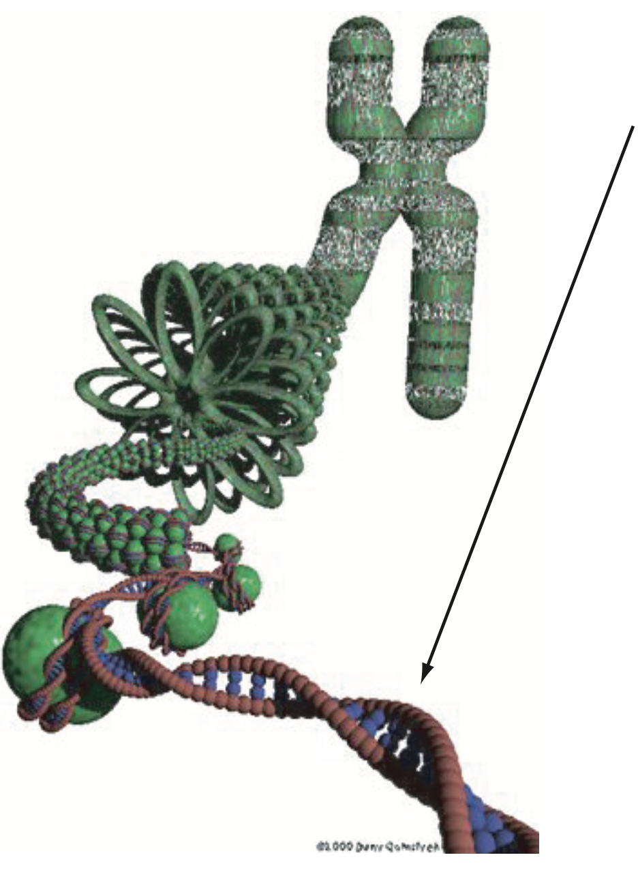{.dna-figure fig-alt="DNA double helix packaged into chromatin and a chromosome; an arrow points to the DNA helix."}

:::
::: {.column width="66%"}

::: {.dna-sequence}
…AGGATCGTGCATGGCTAGCTGATTCCGTATCCGTTC…
:::

- Genetic material consists of long molecules of **DNA** organized into chromosomes.
  - A sequence of A, C, G, or T bases.
- Most organisms we will be concerned with are **diploids**: chromosomes come in pairs, one from mom and the other from dad.
- To reproduce, diploids form **haploid gametes**, eggs and sperm, which unite to create a new diploid.
  - The use of genetics for kin-finding flows entirely from this.

:::
:::

::: {.notes}
Figure extracted without modification from slide 3 of the supplied Genetics Fundamentals.pptx. The original illustration includes its own copyright credit, retained in the image.
:::

## Chromosomes come in pairs {.chromosome-slide}

::: {.columns}
::: {.column width="50%"}

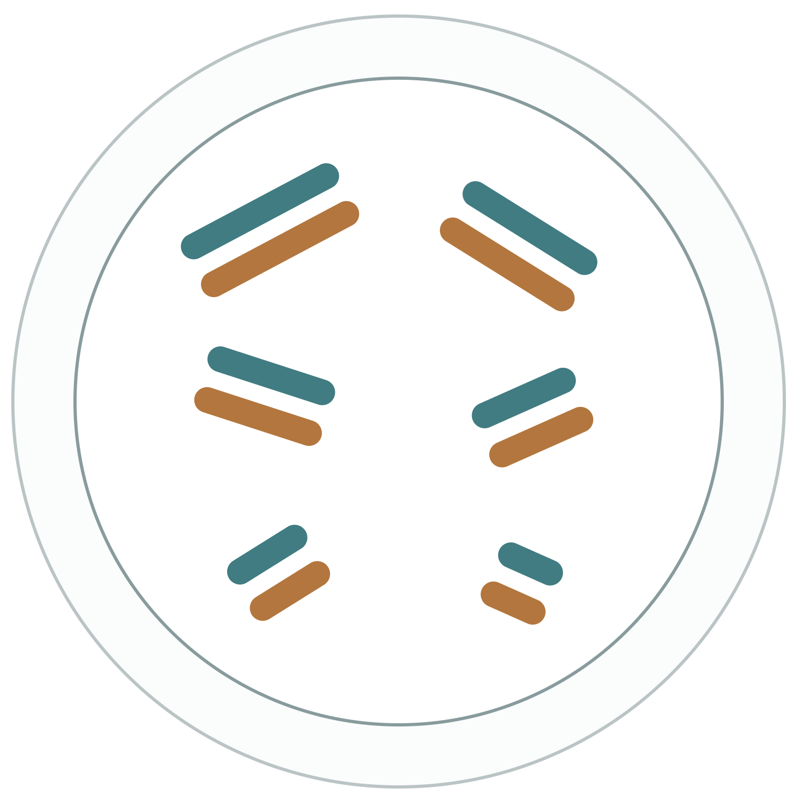{.chromosome-figure fig-alt="A diploid cell with six pairs of chromosomes. Each pair contains one teal maternal copy and one orange paternal copy."}

:::
::: {.column width="50%"}

One from each parent:

::: {.maternal}
**Mom** supplies the **maternal chromosome**, which came from the egg.
:::

::: {.paternal}
**Dad** supplies the **paternal chromosome**, which came from the sperm.
:::

:::
:::

::: {.notes}
Figure extracted without modification from slide 4 of the supplied Genetics Fundamentals.pptx. Maternal and paternal text colors follow the original figure.
:::

## Meiosis and recombination {.figure-pair}

::: {.columns}
::: {.column width="44%"}

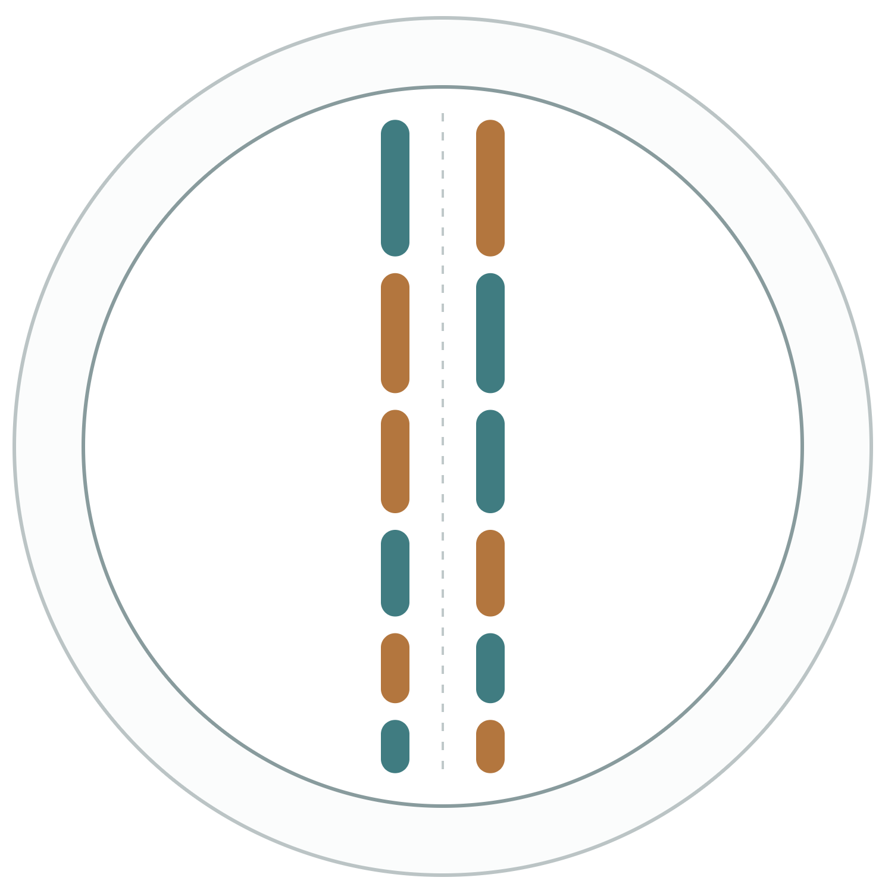{.pedigree-figure fig-alt="Maternal and paternal chromosome segments aligned during meiosis."}
:::
::: {.column width="56%"}
During meiosis, homologous chromosomes assemble together before being pulled into the gametes.

Before they separate, chromosome arms cross over and may exchange segments between the chromosomes.
:::
:::

::: {.notes}
Source: slide 5 of the supplied Genetics Fundamentals.pptx and matching PDF. Figures retain the original artwork; prose and equations are editable Markdown and LaTeX.
:::

## What ends up in the gamete {.figure-pair}

::: {.columns}
::: {.column width="44%"}

{.pedigree-figure fig-alt="Chromatids containing alternating maternal and paternal segments."}
:::
::: {.column width="56%"}
There is quite a bit of complexity in these bundles of chromatids.

For our purposes, it is best to think about the **consequences for what ends up in the gamete**.
:::
:::

::: {.notes}
Source: slide 6 of the supplied Genetics Fundamentals.pptx and matching PDF. Figures retain the original artwork; prose and equations are editable Markdown and LaTeX.
:::

## DNA is inherited in chunks {.gamete-slide}

::: {.gamete-row}
::: {.gamete-cell}
Diploid germ cell

{fig-alt="Diploid germ cell with recombined chromosome pairs."}
:::
::: {.gamete-arrow aria-hidden="true"}
→
:::
::: {.gamete-cell}
Haploid gamete

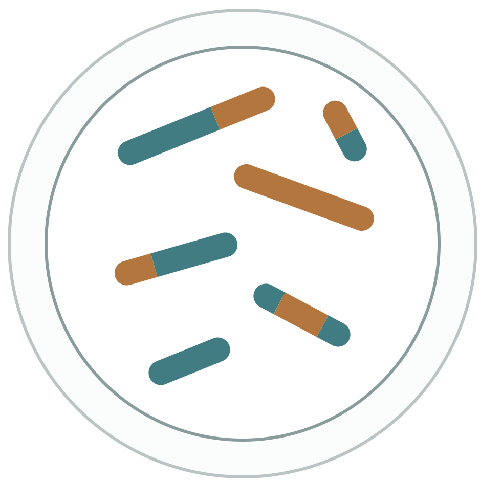{fig-alt="Haploid gamete with one mosaic copy of each chromosome."}
:::
:::

- At any point on an autosome, a gamete gets a copy of maternal or paternal DNA, each with probability $\tfrac12$.
- Independently for each chromosome.
- Maternal versus paternal origin of sites on the **same chromosome is not independent**.

::: {.notes}
Source: slide 7 of the supplied Genetics Fundamentals.pptx and matching PDF. Figures retain the original artwork; prose and equations are editable Markdown and LaTeX.
:::

## Identity by descent {.gamete-slide}

::: {.gamete-row}
::: {.gamete-cell}
Diploid germ cell

{fig-alt="Diploid germ cell with maternal and paternal chromosome segments."}
:::
::: {.gamete-arrow aria-hidden="true"}
→
:::
::: {.gamete-cell}
Haploid gamete

{fig-alt="Gamete carrying DNA copied from the parental chromosomes."}
:::
:::

- When that gamete unites with another, the offspring carries DNA that is an effectively identical copy of half the DNA in its mother and half in its father.
- Such DNA is **identical by descent**, or **IBD**.

::: {.notes}
Source: slide 8 of the supplied Genetics Fundamentals.pptx and matching PDF. Figures retain the original artwork; prose and equations are editable Markdown and LaTeX.
:::

## Parent to offspring {.image-slide}

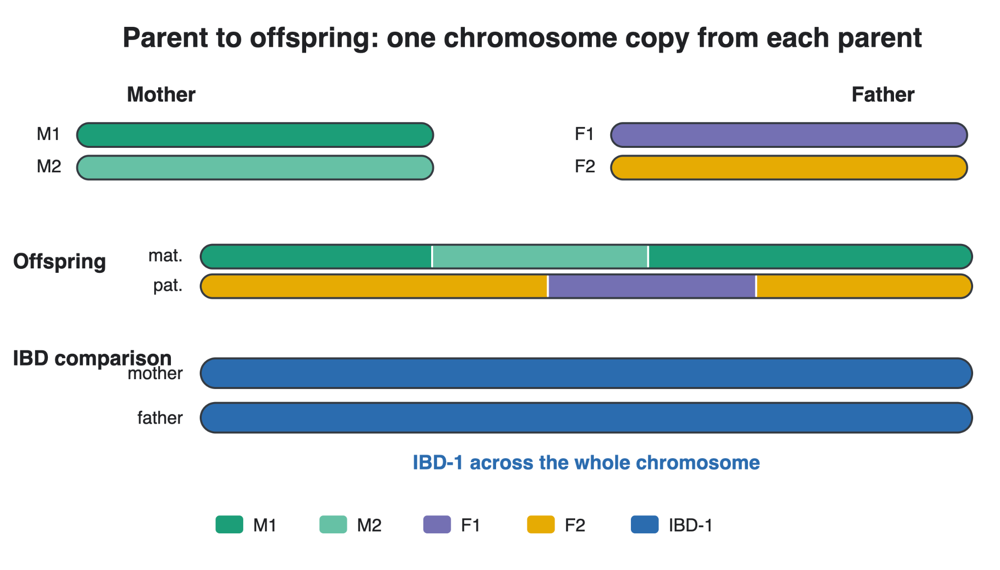{.hero-figure fig-alt="Parental chromosome copies, the offspring's recombinant copies, and IBD-1 across the whole chromosome with each parent."}

::: {.notes}
Source: slide 9 of the supplied Genetics Fundamentals.pptx and matching PDF. Figures retain the original artwork; prose and equations are editable Markdown and LaTeX.
:::

## Parent–offspring IBD {.image-caption-slide}

{.wide-figure fig-alt="An offspring shares one gene copy IBD with each parent along the chromosome."}

A non-inbred parent and its non-inbred offspring **share exactly one gene copy IBD everywhere** in the genome.

Blue denotes **IBD-1**: sharing one gene copy IBD.

::: {.notes}
Source: slide 10 of the supplied Genetics Fundamentals.pptx and matching PDF. Figures retain the original artwork; prose and equations are editable Markdown and LaTeX.
:::

## Half-sibling IBD {.image-caption-slide}

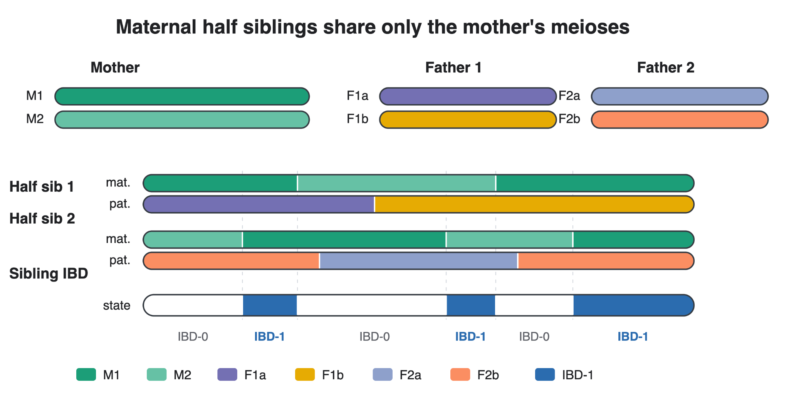{.wide-figure fig-alt="Maternal half siblings inherit mosaics from the same mother and different fathers. Their IBD state alternates between IBD-0 and IBD-1."}

Half siblings can share some of their genome **IBD-1** and the rest **IBD-0** (not IBD).

How much on average? We will calculate that shortly.

::: {.notes}
Source: slide 11 of the supplied Genetics Fundamentals.pptx and matching PDF. Figures retain the original artwork; prose and equations are editable Markdown and LaTeX.
:::

## Full-sibling IBD {.image-caption-slide}

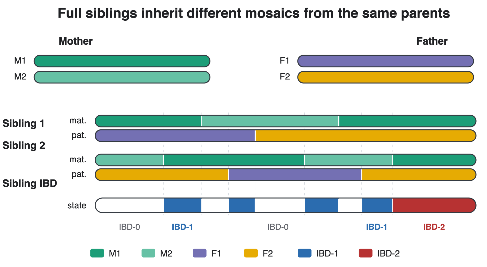{.wide-figure fig-alt="Full siblings inherit different mosaics from the same parents; their IBD state alternates among IBD-0, IBD-1, and IBD-2."}

Full-sibling pairs can share **IBD-0, IBD-1, or IBD-2** in their genomes.

::: {.notes}
Source: slide 12 of the supplied Genetics Fundamentals.pptx and matching PDF. Figures retain the original artwork; prose and equations are editable Markdown and LaTeX.
:::

## Cotterman coefficients {.coefficient-slide}

Let $\kappa_0$, $\kappa_1$, and $\kappa_2$ denote the expected fractions of the genome in states IBD-0, IBD-1, and IBD-2, given a relationship.

::: {.columns}
::: {.column width="30%"}
::: {.r-stack}

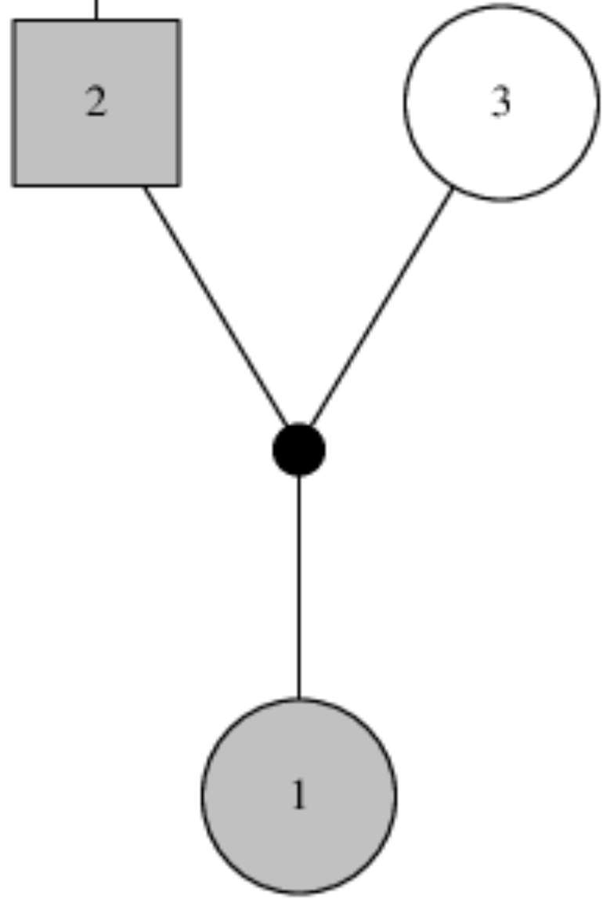{.pedigree-figure fig-alt="Pedigree with a father, a mother, and their offspring."}

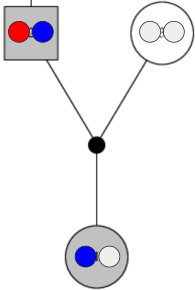{.pedigree-figure .fragment fragment-index=0 fig-alt="The father's two gene copies are red and blue; the offspring inherits one of them."}
:::
:::
::: {.column width="70%"}
::: {.fragment fragment-index=1}
Two possibilities, each with probability $\tfrac12$:

- The offspring inherits Dad's [blue]{.allele-blue} gene copy.
- The offspring inherits Dad's [red]{.allele-red} gene copy.
:::

::: {.fragment fragment-index=2}
In both cases, Dad and the offspring share **one gene copy IBD**.

For parent–offspring:

$$\boldsymbol{\kappa}=(0,1,0).$$
:::
:::
:::

::: {.notes}
Source: slide 13 of the supplied Genetics Fundamentals.pptx and matching PDF. Figures retain the original artwork; prose and equations are editable Markdown and LaTeX.
:::

## Cotterman coefficients for half siblings {.coefficient-slide}

Maternal half siblings

::: {.columns}
::: {.column width="44%"}

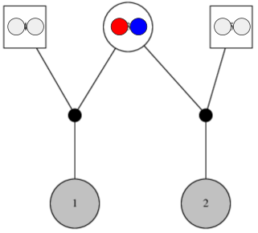{.pedigree-figure fig-alt="Two maternal half siblings; the shared mother carries one red and one blue gene copy."}
:::
::: {.column width="56%"}
Individual 1 gets [red]{.allele-red} with probability $\tfrac12$, and individual 2 independently gets [red]{.allele-red} with probability $\tfrac12$:

$$\tfrac12\times\tfrac12=\tfrac14.$$

**Or**, both inherit [blue]{.allele-blue}, also with probability $\tfrac14$.

So:

$$\boldsymbol{\kappa}=(\tfrac12,\tfrac12,0).$$
:::
:::

::: {.notes}
Source: slide 14 of the supplied Genetics Fundamentals.pptx and matching PDF. Figures retain the original artwork; prose and equations are editable Markdown and LaTeX.
:::

## Enumerating the half-sibling cases {.coefficient-slide}

Or, even simpler, enumerate the four equiprobable cases.

::: {.columns}
::: {.column width="38%"}

{.pedigree-figure fig-alt="Pedigree for two maternal half siblings."}
:::
::: {.column width="32%"}
::: {.r-stack}

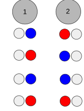{.cases-figure fig-alt="The four combinations of maternally inherited copies: red-blue, blue-red, blue-blue, and red-red for individuals 1 and 2."}

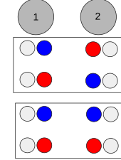{.cases-figure .fragment fragment-index=0 fig-alt="The four cases grouped into two with no shared copy and two with one shared copy."}
:::
:::
::: {.column width="30%"}
::: {.fragment fragment-index=0}
$$\kappa_0=\frac24=\frac12$$

$$\kappa_1=\frac24=\frac12$$
:::
:::
:::

::: {.notes}
Source: slide 15 of the supplied Genetics Fundamentals.pptx and matching PDF. Figures retain the original artwork; prose and equations are editable Markdown and LaTeX.
:::

## Full siblings: two independent half-sibling processes {.coefficient-slide .compact}

::: {.columns}
::: {.column width="30%"}

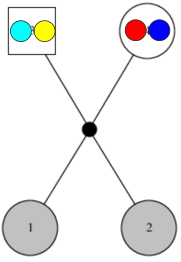{.pedigree-figure fig-alt="Full-sibling pedigree with two distinct gene copies in each parent."}
:::
::: {.column width="70%"}
Individuals 1 and 2 share, from Dad:

- Zero gene copies IBD with probability $\tfrac12$.
- One gene copy IBD with probability $\tfrac12$.

Independently, the same possibilities apply to the copies from Mom.

The total number of gene copies shared is the sum of **two independent Bernoulli random variables**:

$$\boldsymbol{\kappa}=(\tfrac14,\tfrac12,\tfrac14).$$

Full siblings can share **two copies IBD** even when neither individual is inbred.
:::
:::

::: {.notes}
Source: slide 16 of the supplied Genetics Fundamentals.pptx and matching PDF. Figures retain the original artwork; prose and equations are editable Markdown and LaTeX.
:::

## Half-thiatic pairs {.coefficient-slide}

Half-aunt–niece, half-avuncular, etc.

::: {.columns}
::: {.column width="32%"}

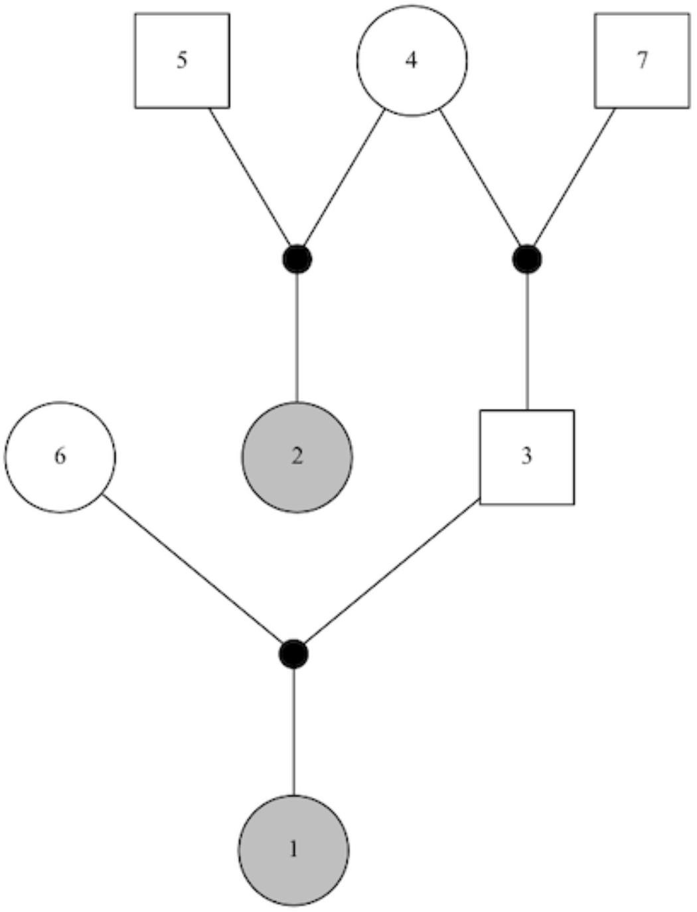{.pedigree-figure fig-alt="Pedigree in which individuals 2 and 3 are half siblings, and individual 1 is an offspring of individual 3."}
:::
::: {.column width="68%"}
Individuals 1 and 2 share a gene copy IBD only if:

- Individuals 2 and 3 share a gene copy IBD, **and**
- That shared copy is transmitted from 3 to 1.

Individuals 2 and 3 are half siblings, so they share one copy IBD with probability $\tfrac12$.

Individual 3 transmits that particular copy to 1 with probability $\tfrac12$.

$$\boldsymbol{\kappa}=(\tfrac34,\tfrac14,0).$$
:::
:::

::: {.notes}
Source: slide 17 of the supplied Genetics Fundamentals.pptx and matching PDF. Figures retain the original artwork; prose and equations are editable Markdown and LaTeX.
:::

## Cotterman coefficients across relationships {.coefficient-slide}

::: {.columns}
::: {.column width="48%"}
::: {.r-stack}

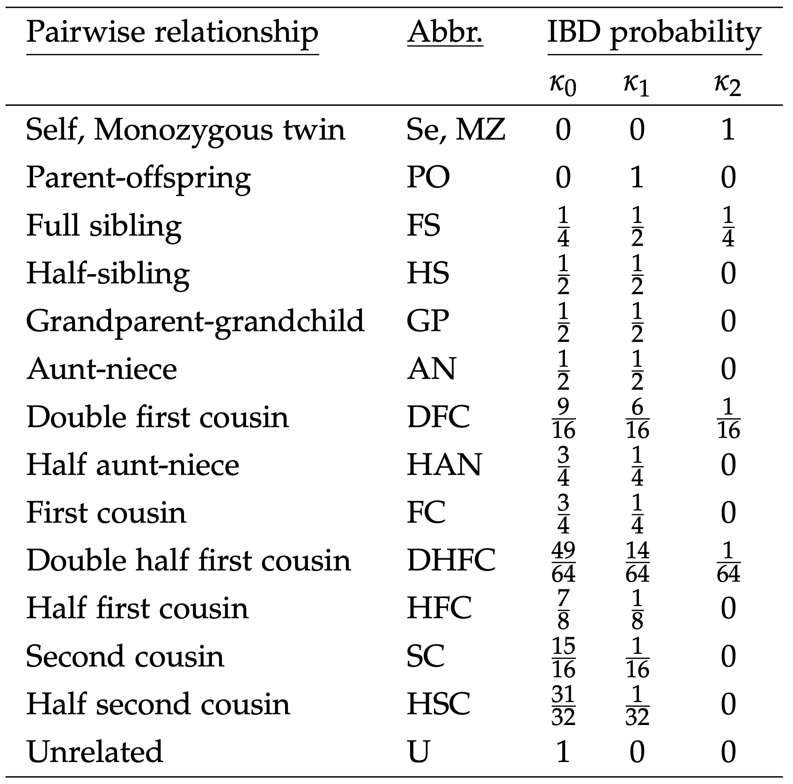{.table-figure fig-alt="Table of Cotterman coefficients for self, parent-offspring, siblings, avuncular pairs, cousins, and unrelated pairs."}

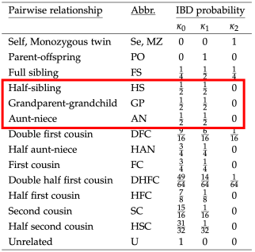{.table-figure .fragment fragment-index=0 fig-alt="Half siblings, grandparent-grandchild, and aunt-niece highlighted: each has coefficients one-half, one-half, zero."}
:::
:::
::: {.column width="52%"}
As the shared ancestor gets further back in generations, the expected fraction of shared genome decreases by a factor of $\tfrac12$ for each meiosis.

::: {.fragment .emphasis fragment-index=0}
Note the three relationships with the same expected fraction of IBD:

- Half-sibling
- Full-thiatic (aunt/uncle–niece/nephew)
- Grandparent–grandchild
:::
:::
:::

::: {.notes}
Source: slide 18 of the supplied Genetics Fundamentals.pptx and matching PDF. Figures retain the original artwork; prose and equations are editable Markdown and LaTeX.
:::

## Take-home message about IBD

- If we could see IBD and measure its proportion across the genome, it would tell us something about a pair's relationship: the Cotterman coefficients give the expected fractions in each IBD state.
- We do not observe IBD directly. We have to use what we **can** observe.
- We can observe places in the genome where individuals carry different genetic sequences.
- It is easiest to think of these as **sequence variants**, although a variant can be any difference in the genome.

::: {.notes}
Source: slide 19 of the supplied Genetics Fundamentals.pptx and matching PDF. Figures retain the original artwork; prose and equations are editable Markdown and LaTeX.
:::

## Single-nucleotide polymorphisms {.image-caption-slide}

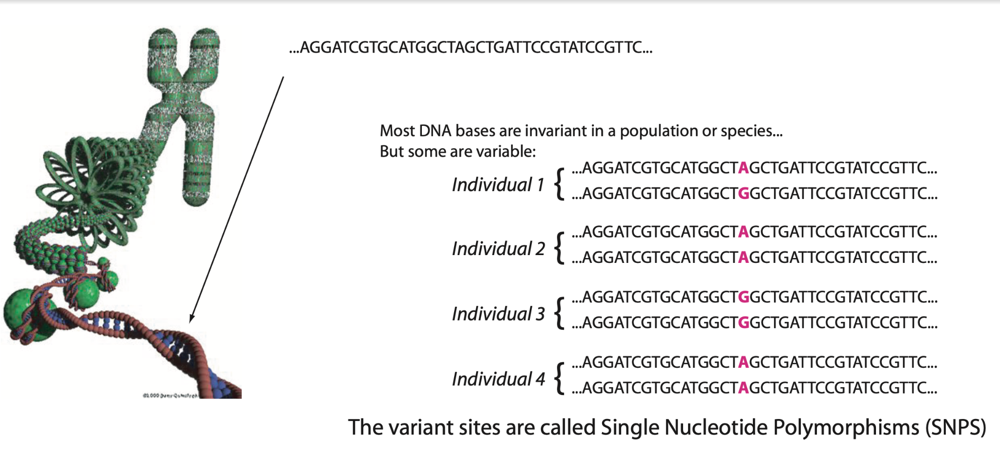{.wide-figure fig-alt="DNA sequences from four individuals aligned at a variable nucleotide position."}

The different possible forms at a variant are called **alleles**.

At a SNP, the possible alleles are A, C, G, or T.

::: {.notes}
Source: slide 20 of the supplied Genetics Fundamentals.pptx and matching PDF. Figures retain the original artwork; prose and equations are editable Markdown and LaTeX.
:::

## Genotypes {.compact}

- In a diploid, the **genotype** is the unordered combination of alleles at a variant.
- At a nucleotide position, possible alleles are A, C, G, or T. Most SNPs have only two observed alleles, for example A and G.
- Other types of genetic markers may have more alleles.
- List the possible alleles as $a_1,a_2,\ldots$. The genotype $G_i$ of diploid individual $i$ combines the allelic types of its two gene copies:

$$
\begin{aligned}
G_i&=a_1a_1 &&\text{a homozygote}\\
G_i&=a_1a_2 &&\text{a heterozygote}\\
G_i&=a_3a_4 &&\text{a heterozygote}
\end{aligned}
$$

::: {.notes}
Source: slide 21 of the supplied Genetics Fundamentals.pptx and matching PDF. Figures retain the original artwork; prose and equations are editable Markdown and LaTeX.
:::

## Genotypes in populations {.compact}

The overwhelmingly simple model of how alleles find themselves in an individual

- Regard the population at a variant as a barrel of balls of different colors.
- Each color denotes an allele; allele $a$ has relative frequency $f(a)$.
- Model an individual's genotype as **two independent draws** from that barrel.

$$
\begin{aligned}
G_i=a_1a_1 &\qquad P(G_i)=f(a_1)^2\\
G_i=a_1a_2 &\qquad P(G_i)=2f(a_1)f(a_2)\\
G_i=a_3a_4 &\qquad P(G_i)=2f(a_3)f(a_4)
\end{aligned}
$$

In large, randomly mating populations, this is a reliable model. If observed genotypes do not follow these **Hardy–Weinberg proportions**, investigate why.

::: {.notes}
Source: slide 22 of the supplied Genetics Fundamentals.pptx and matching PDF. Figures retain the original artwork; prose and equations are editable Markdown and LaTeX.
:::

## Genotypes at different variants {.compact}

The overwhelmingly simple model, part 2

- The typical assumption is that the allelic types carried by an individual at one variant are independent of those carried by that individual at another variant.
- Each variant gets alleles drawn independently from its own bucket.
- This is also typically reliable in large, randomly mating populations, and it can be checked.
- When genotype frequencies across loci do not suggest independence, the loci are in **linkage disequilibrium (LD)**.
- LD might indicate population structure, inversions, markers close together in the genome, etc.

::: {.emphasis}
These assumptions give simple predictions that can be checked for violations.
:::

::: {.notes}
Source: slide 23 of the supplied Genetics Fundamentals.pptx and matching PDF. Figures retain the original artwork; prose and equations are editable Markdown and LaTeX.
:::

## Allelic types and identity by descent

How can genotypes be used to infer IBD, and hence relationships?

If individuals 1 and 2 share a gene copy IBD, the allelic type of that copy is the same in both individuals.

- Related individuals' genotypes are therefore **not independent**.
- Their **joint genotype probability** is not simply the product of their genotype probabilities.

::: {.notes}
Source: slide 24 of the supplied Genetics Fundamentals.pptx and matching PDF. Figures retain the original artwork; prose and equations are editable Markdown and LaTeX.
:::

## Joint genotype probability of a pair {.compact .joint-probability-slide}

At one locus, let $G_1$ and $G_2$ be the two genotypes and let $\boldsymbol{\kappa}=(\kappa_0,\kappa_1,\kappa_2)$ describe the relationship. Assume neither individual is inbred and condition on population allele frequencies.

$$
\begin{aligned}
P(G_1,G_2\mid\boldsymbol{\kappa})
&=\underbrace{\kappa_0P(G_1)P(G_2)}_{\text{no gene copies IBD}}\\[0.5em]
&\quad+\underbrace{\kappa_1P(G_1)P(G_2\mid G_1,\,2=\mathrm{kid},\,1=\mathrm{par})}_{\text{one gene copy IBD}}\\[0.5em]
&\quad+\underbrace{\kappa_2P(G_1)\mathbf{1}\{G_2=G_1\}}_{\text{two gene copies IBD}}.
\end{aligned}
$$

The probability of $G_2$ given $G_1$ and one gene copy shared IBD is calculated as follows…

::: {.notes}
Source: slide 25 of the supplied Genetics Fundamentals.pptx and matching PDF. Figures retain the original artwork; prose and equations are editable Markdown and LaTeX.
:::

## Sharing one gene copy IBD {.conditional-slide}

Conditional genotype probabilities $P(G_2\mid G_1,\text{ one copy IBD})$

$$
\begin{array}{c|ccccc}
 & a_ia_i & a_ia_j & a_ia_k & a_ja_k & a_ka_\ell\\[0.4em]\hline
 a_ia_i & f(a_i) & f(a_j) & f(a_k) & 0 & 0\\[0.5em]
 a_ia_j & \tfrac12 f(a_i) & \tfrac12[f(a_i)+f(a_j)] & \tfrac12f(a_k) & \tfrac12f(a_k) & 0
\end{array}
$$

Rows give $G_1$, columns give $G_2$, and $i,j,k,\ell$ denote distinct allelic types.

The main point: it is straightforward to calculate

$$P(G_1,G_2\mid\boldsymbol{\kappa}).$$

::: {.notes}
Source: slide 26 of the supplied Genetics Fundamentals.pptx and matching PDF. Figures retain the original artwork; prose and equations are editable Markdown and LaTeX.
:::

## Weighing evidence between relationships {.compact}

$P(G_1,G_2\mid\boldsymbol{\kappa})$ is the joint probability of two genotypes at one locus, given their relationship. It is also the **likelihood of $\boldsymbol{\kappa}$** given the genotypes.

Consider half siblings (HS) versus unrelated (U):

$$
\lambda_{\mathrm{HS/U}}^{(\ell)}=\log
\frac{P\!\left(G_1^{(\ell)},G_2^{(\ell)}\mid\boldsymbol{\kappa}=(\tfrac12,\tfrac12,0)\right)}
{P\!\left(G_1^{(\ell)},G_2^{(\ell)}\mid\boldsymbol{\kappa}=(1,0,0)\right)}.
$$

This is a **log-likelihood ratio at a single variant** $\ell$.

For any two relationships $R_1$ and $R_2$, use their respective coefficient vectors to obtain $\lambda_{R_1/R_2}^{(\ell)}$.

::: {.notes}
Corrected an apparent source typo: the unrelated coefficient vector in the supplied slide is (0,0,0); it must be (1,0,0). Cotterman coefficients sum to one.
:::

::: {.notes}
Source: slide 27 of the supplied Genetics Fundamentals.pptx and matching PDF. Figures retain the original artwork; prose and equations are editable Markdown and LaTeX.
:::

## Combining evidence across variants {.compact}

Sum the single-variant log-likelihood ratios over all $L$ variants:

$$\Lambda_{R_1/R_2}=\sum_{\ell=1}^{L}\lambda_{R_1/R_2}^{(\ell)}.$$

When both relationships are among **unrelated, parent–offspring, and self/clone**, and markers are not in LD, this is a proper log-likelihood ratio under the model.

For the other relationship comparisons considered here, physical linkage generally means it is not a proper log-likelihood ratio.

We can call it **pseudo log-odds**, or a **PLOD**. It is still very useful.

::: {.notes}
Source: slide 28 of the supplied Genetics Fundamentals.pptx and matching PDF. Figures retain the original artwork; prose and equations are editable Markdown and LaTeX.
:::

## Why is it not a proper log-likelihood ratio? {.linkage-slide}

{.wide-figure fig-alt="Half siblings share IBD in continuous chromosome segments, creating correlated IBD states across nearby variants."}

Summing per-variant log-likelihoods treats the pair's genotype observations as independent **across variants**.

Physical linkage makes that assumption fail. But all is not lost.

::: {.notes}
Clarified that the independence assumption is across variants for a pair, rather than independence between the two related individuals at a locus.
:::

::: {.notes}
Source: slide 29 of the supplied Genetics Fundamentals.pptx and matching PDF. Figures retain the original artwork; prose and equations are editable Markdown and LaTeX.
:::

## Properties of $\Lambda_{R_1/R_2}$ {.compact}

$\Lambda_{R_1/R_2}$ is a sum of $L$ random variables. For large $L$, under suitable conditions, it has an approximately normal distribution.

Its **expected value** is unaffected by correlation due to physical linkage:

$$
\operatorname{E}\!\left(\Lambda_{R_1/R_2}\right)
=\sum_{\ell=1}^{L}\operatorname{E}\!\left(\lambda_{R_1/R_2}^{(\ell)}\right).
$$

However, its **variance and higher moments** are affected by correlation between terms due to physical linkage.

Using $\Lambda_{R_1/R_2}$ requires accounting for that increased variance.

::: {.notes}
Source: slide 30 of the supplied Genetics Fundamentals.pptx and matching PDF. Figures retain the original artwork; prose and equations are editable Markdown and LaTeX.
:::

## Assuming unlinked markers understates variance {.image-slide}

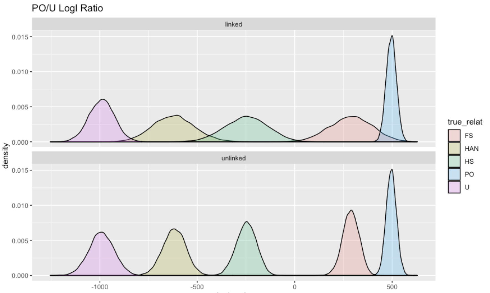{.hero-figure fig-alt="Parent-offspring versus unrelated log-ratio densities by true relationship. Linked markers produce broader densities than unlinked markers."}

::: {.notes}
Source: slide 31 of the supplied Genetics Fundamentals.pptx and matching PDF. Figures retain the original artwork; prose and equations are editable Markdown and LaTeX.
:::
