## Sequencing, genotyping methods, and genotyping error {.opening-slide}

Eric C. Anderson

Hawaiʻi CKMR Workshop 2026

## Overview

- How sequencing becomes genotype data
- Which parts of the genome to target
- Heterozygote miscalls in RAD data: diagnostics and estimation
- Capture and amplicon sequencing
- Microhaplotypes
- Error in genotyping
- Overview of some special, relevant topics:
  - mtDNA, maternal inheritance
  - Genetically inferred sex
  - Epigenetic ageing

## Sample aquisition

Lots of expertise in this room on that.  I like Mark's summary:

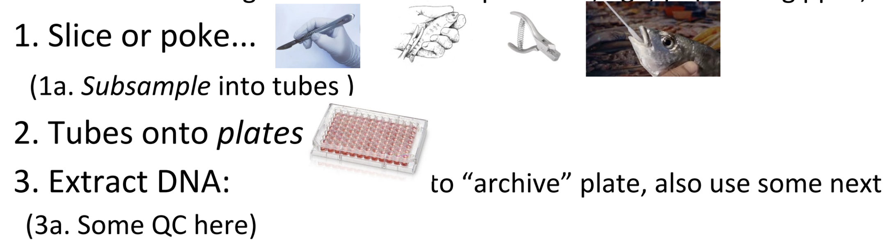

Key point: DNA samples can be obtained quickly and non-lethally

## Next-generation sequencing

- Many genotyping technologies today do not use NGS:
    - Traditional Microsatellites
    - SNP chips
    - Fluidigm assays
- Nonetheless, CKMR is feasible today because of high-throughput sequencing.
- You (or someone on your team) needs some background/understanding of the genotyping technology you use.
- We'll discuss Illumina sequencing today.  (most common and cost effective)

## Library preparation

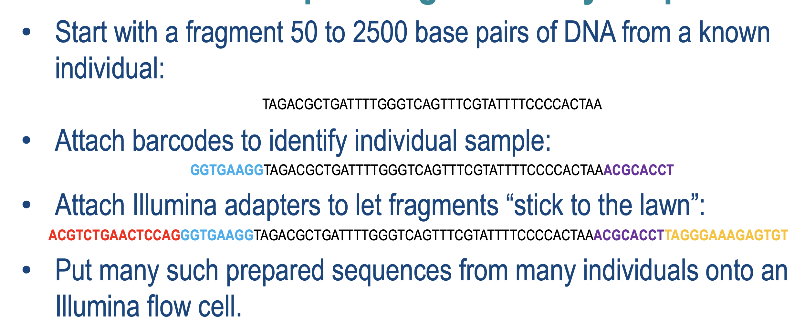

## Inside the sequencer {.genotyping-columns}

::: {.columns}
::: {.column width="35%"}
- Fragments bind to the flow cell (i.e., "the lawn").
- Clusters of copies form.
- Bases are read by sequencing by synthesis.
- **Paired-end sequencing** reads both ends of a fragment.
:::
::: {.column width="65%"}
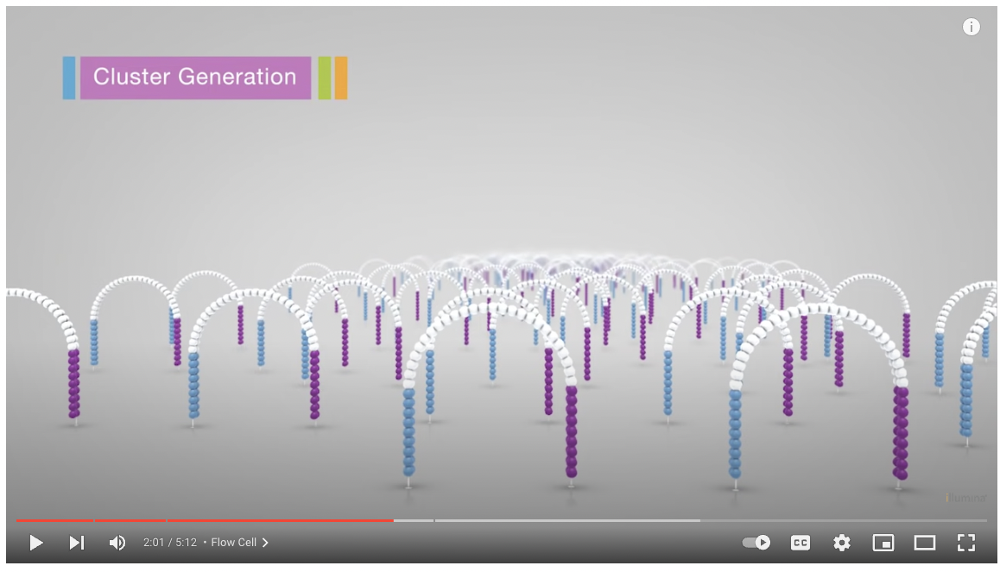{.method-figure fig-alt="Illumina sequencing animation showing clusters on a flow cell."}

[Illumina sequencing video](https://www.youtube.com/watch?v=fCd6B5HRaZ8)
:::
:::

## The raw data: FASTQ {.genotyping-figure}

Paired end sequences, sample-specific FASTQ files

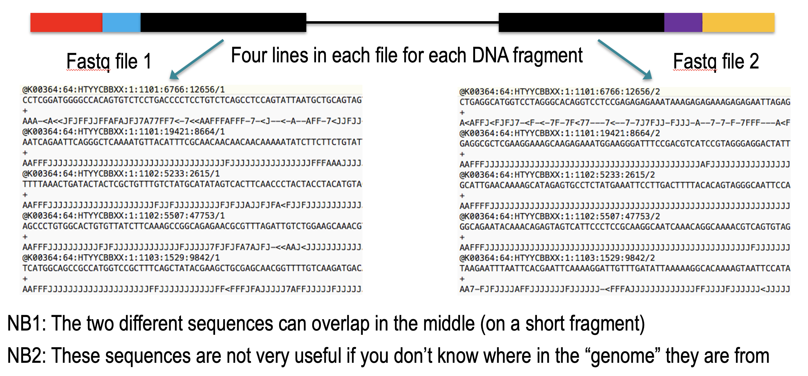{.genotyping-wide fig-alt="Paired-end sample-specific FASTQ files: four lines per read, with matching reads from the two ends of each fragment."}

FASTQ records contain a sequence and base-quality information for each read. Paired-end runs produce corresponding read-1 and read-2 records.

We need a way to identify which genomic region each read came from. (Align to a _reference_)

## What counts as a reference?

A reference can be:

- A chromosome-level genome assembly
- A collection of assembled RAD loci or “stacks”
- A set of known amplicon sequences

It is a collection of sequences against which reads can be compared.

A complete genome is useful, but **not every genotyping workflow requires one**.

## Alignment or mapping

Find where each read belongs in the reference sequence collection.

After initial quality control, mapping gives us:

- An aligned position for the read
- Mismatches, gaps, and unaligned portions
- A measure of confidence in the placement

The confidence in the mapping is distinct from the confidence in a genotype call.

## Aligned reads, zoomed in {.genotyping-figure}

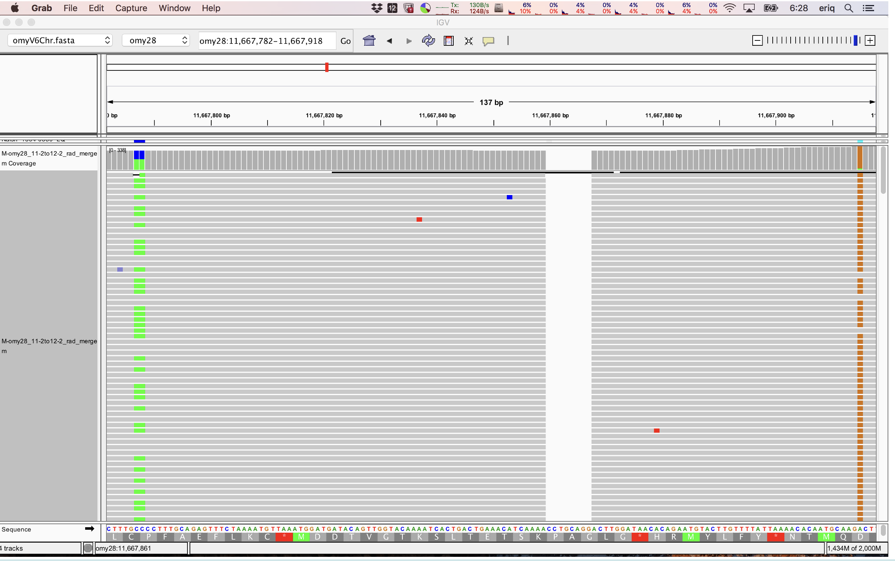{.genotyping-hero fig-alt="Genome browser view of aligned reads and individual base mismatches."}

::: {.notes}
2022 aligned reads zoomed in; 2019 slide 9.
:::

## Aligned reads, zoomed out {.genotyping-figure}

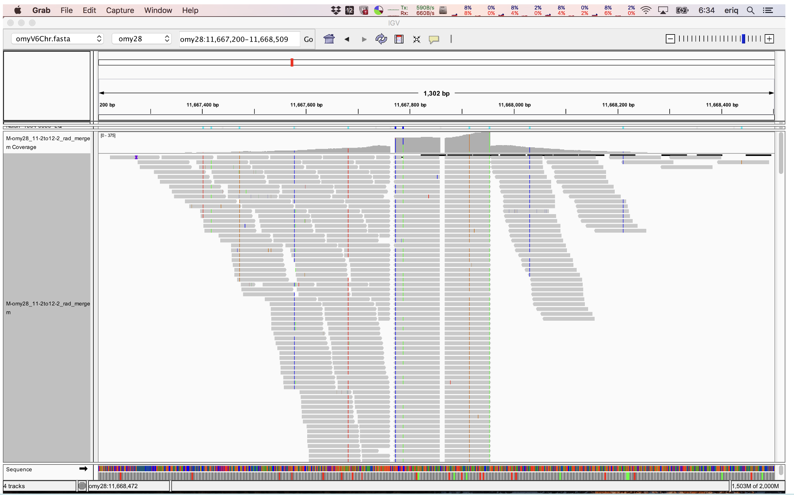{.genotyping-hero fig-alt="Genome browser view showing read alignments at a broader genomic scale."}

::: {.notes}
2022 aligned reads zoomed out; 2019 slide 10. Stray x removed.
:::

## Variant detection and genotype calling

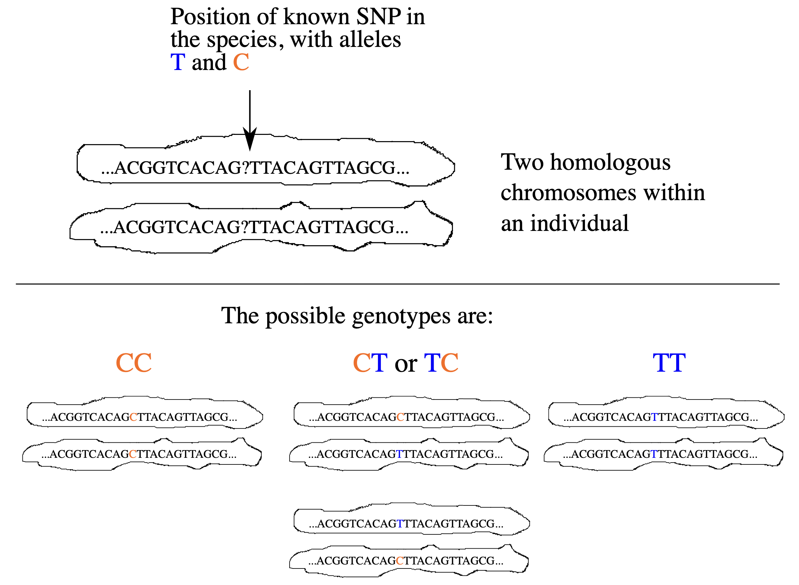

## Variant detection and genotype calling

**Variant detection:** identify genomic positions that vary among sampled individuals, such as SNPs and indels.

**Genotype calling:** infer an individual's alleles at a particular variant.

- A sequenced fragment comes from one chromosome copy.
- Fragments from both homologous copies align to the same locus.
- More usable coverage generally gives more information about both copies.
- Systematic errors still require attention, even at high depth.

::: {.notes}
2022 Variant Detection and Genotype Calling; 2019 slide 11.
:::

## The fundamental sequencing tradeoff

A sequencing budget buys a finite number of reads or read-pairs.

$$
\text{mean read-pairs per individual per locus}
\approx\frac{R}{N\,L},
$$

where $R$ is usable read-pairs, $N$ is individuals, and $L$ is targeted base pairs

- More individuals or more loci reduces coverage at a fixed $R$.
- Targeting less of the genome can concentrate coverage where it matters.
- Actual coverage is uneven across individuals and loci.

## A current sequencing-budget example {.price-slide}

**NovaSeq X, 10B flow-cell lane, 2 × 150 bp, at UC Berkeley Core (June 2026)**

- Published service output: approximately **1.25 billion read-pairs per lane**
- Published external rate: **US$1,765 per lane**, sequencing service

- Each read pair = 300 bp.  1.25 B pairs $\approx$ 375 Billion base pairs 
- In a 1 Gb genome that is an average of 375 reads per base pair.
- Coverage is **never** even, _especially_ when targeting subsets of the genome.

## Targeting subsets of the genome?

- **Whole-genome sequencing:** no targeted subset
- **RAD/ddRAD:** sequences around restriction-enzyme cut sites
- **Capture:** sequences selected by probe hybridization
- **RAD plus capture:** selected restriction fragments
- **Amplicon sequencing:** regions amplified by multiplexed PCR

The choice determines how the read budget is distributed.

## Whole-genome data {.genotyping-figure}

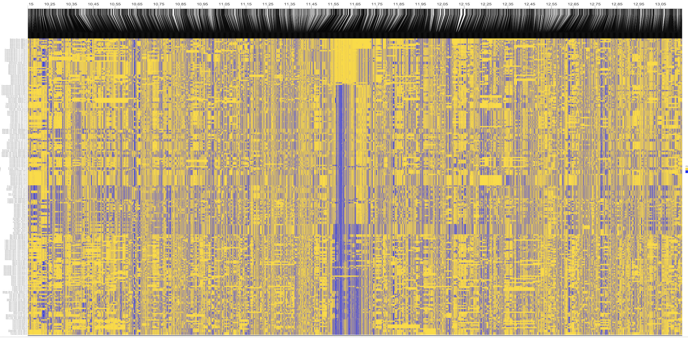{.genotyping-wide fig-alt="Dense whole-genome variation across three megabases of steelhead chromosome 28 in 124 individuals."}

Three megabases of chromosome 28 in 124 steelhead: a tremendous amount of information.

I would not recommend for tens of thousands of samples. 

Perhaps for followup/confirmation. (We will discuss later this week)

## RAD-seq and ddRAD-seq {.genotyping-figure}

::: {.rad-diagram-crop}
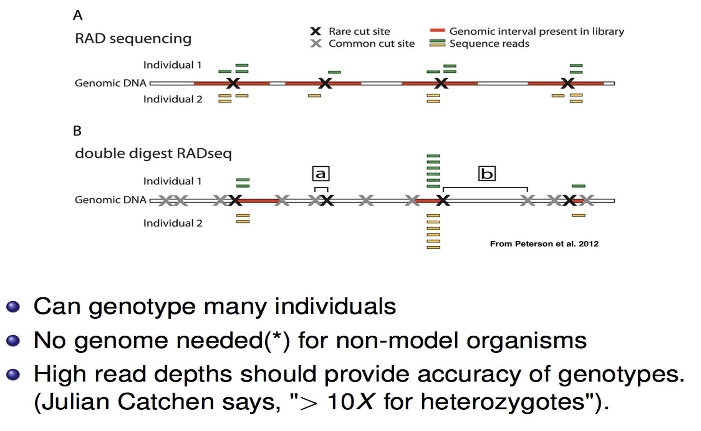{fig-alt="RAD and double-digest RAD protocols selecting DNA around enzyme cut sites; original illustration credits Peterson et al. 2012."}
:::

Restriction enzymes and size selection determine the subset of fragments sequenced.

A nominal depth cutoff alone does **not** establish genotype accuracy.

There seems to be a real art to consistently typing the same markers in different libraries

## RAD concentrates coverage at selected loci {.genotyping-columns}

::: {.columns}
::: {.column width="50%"}
**Sparse genome-wide coverage**

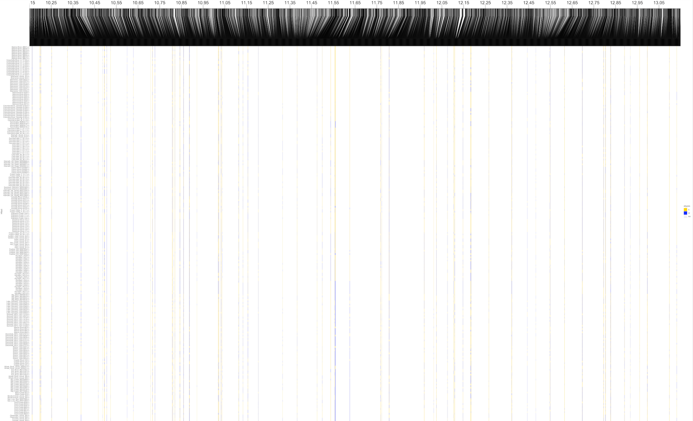{.method-figure fig-alt="RAD variant coverage occupies a small subset of the genome."}
:::
::: {.column width="50%"}
**More reads at the selected loci**

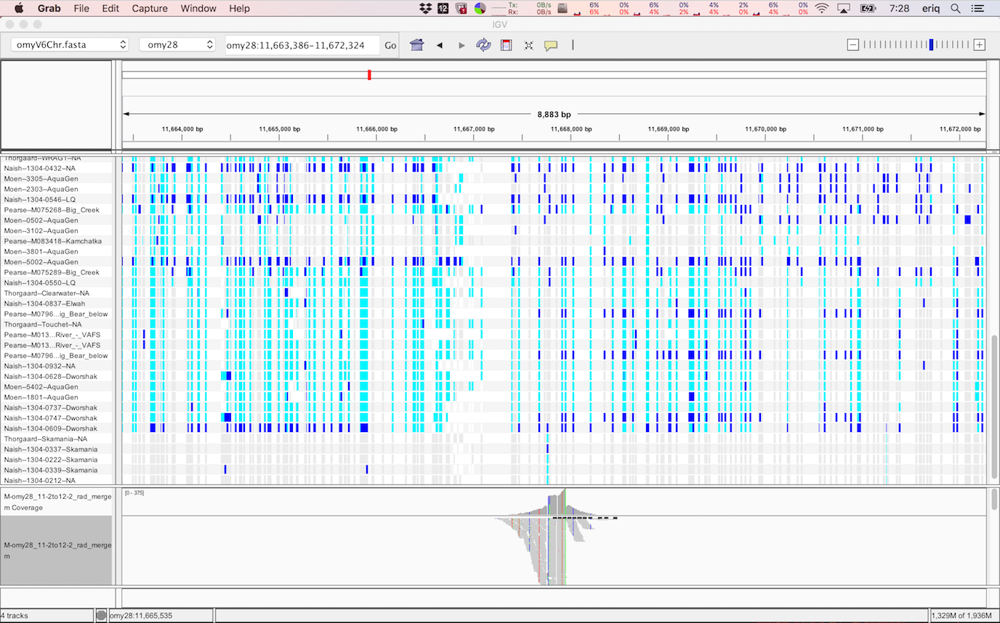{.method-figure fig-alt="Genome browser view of high read depths around targeted RAD loci."}
:::
:::

::: {.notes}
Restored from 2019 slides 18–19. These are original empirical illustrations, not current instrument benchmarks.
:::

## What RAD gets you

- Thousands to many thousands of loci, depending on protocol and genome
- A route to marker discovery in a species without an established panel
- Missing genotypes when loci or individuals receive insufficient usable reads
- Potentially unreliable calls even among genotypes recorded as non-missing

Doing RAD "in-house" for CKMR?

- Doing so would require a lab with deep RAD experience
- Pitfalls: Cost, missing data, heterozygote miscall
- Can be useful for confirming kin pairs discovered with less expensive methods

## Prominent ways that RAD can go wrong

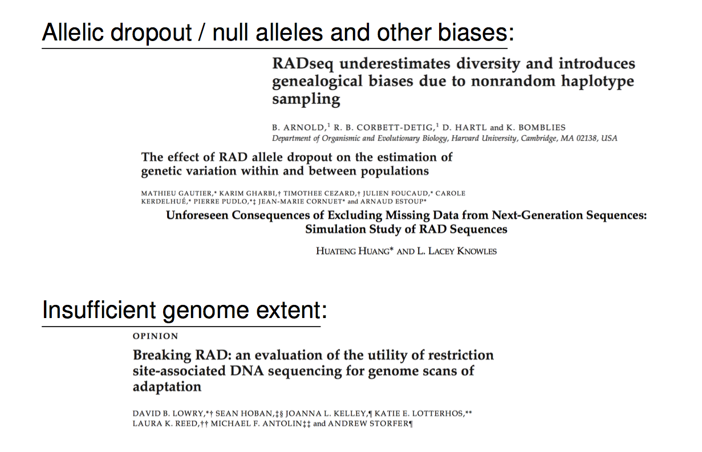

## Two routes to allele dropout

**Systematic loss / null alleles**

An allele may fail to enter the observed library, for example when a restriction site or primer-binding site differs. (This can be dealt with).

**Heterozygote miscall**

A true heterozygote is called a homozygote because the evidence for one allele is lost or insufficient. (This is harder to address)

The observed outcome can look similar, but the mechanisms and remedies differ.

::: {.notes}
2019 slide 21. The original literature examples are Arnold et al. (2013), Gautier et al. (2013), Huang and Knowles (2016), and Lowry et al. (2017). The source image remains available in assets as rad-criticisms.png. More sequencing cannot necessarily recover an allele that failed to enter the library.
:::

## A simple genotype-frequency diagnostic {.genotyping-figure}

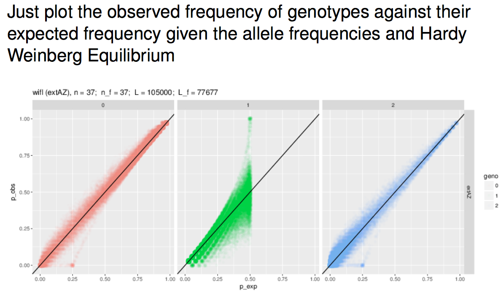{.genotyping-wide fig-alt="Willow flycatcher called-genotype frequencies plotted against Hardy–Weinberg expected frequencies, with separate panels for the three genotypes."}

Compare observed genotype frequencies with the expectations based on allele frequency and Hardy–Weinberg equilibrium (HWE).

This is a **diagnostic**, not by itself proof of genotyping error.

::: {.notes}
2019 slide 22, original willow flycatcher example and diagnostic plots.
:::

## A less reassuring example {.genotyping-figure}

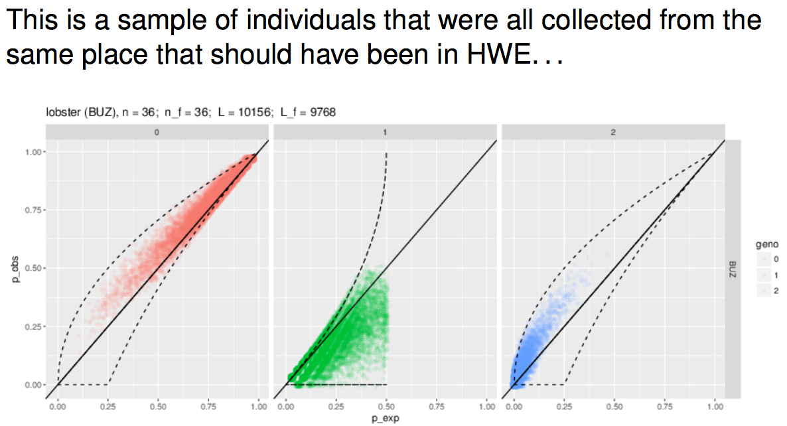{.genotyping-wide fig-alt="Lobster RAD genotype-frequency plots show a substantial heterozygote deficit relative to HWE expectations."}

Lobster data from Benestan et al. (2015).

How much heterozygote miscall would be needed to produce a pattern like this under the model?

## A simple model for het miscall {.model-slide}

One simple **symmetric** miscall model is:

$$
\begin{array}{c|ccc}
&Y=0&Y=1&Y=2\\\hline
X=0&1&0&0\\
X=1&m/2&1-m&m/2\\
X=2&0&0&1
\end{array}
$$

Rows are true genotypes; columns are observed calls.

- Only true heterozygotes are miscalled in this simplified model.
- Each homozygote outcome is equally likely conditional on a miscall.

## A model for heterozygote miscalls {.dag-slide}

How much error must there be for things to look so bad?

::: {.columns}
::: {.column width="35%"}
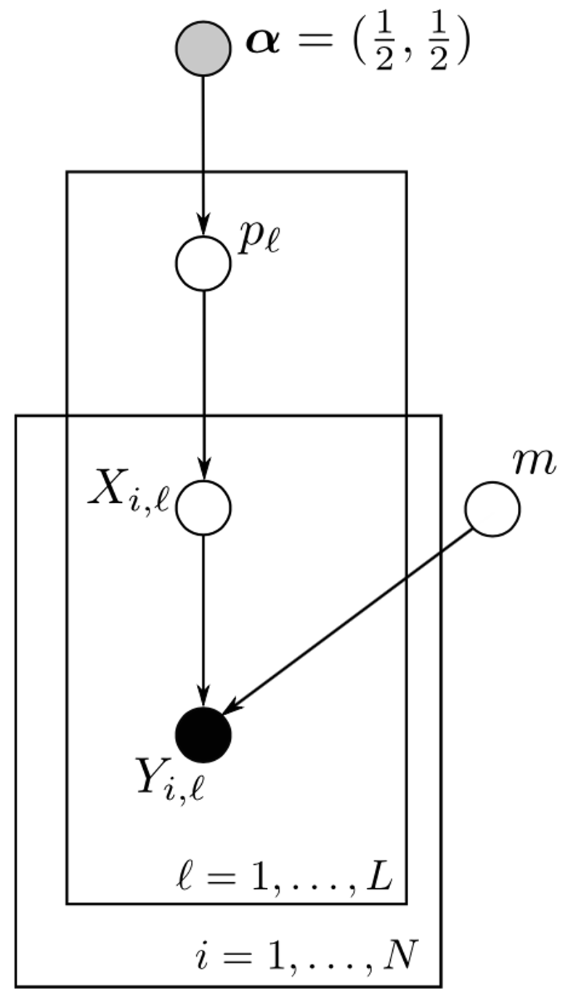{height=480px .dag-figure fig-alt="Hierarchical model: allele-frequency prior alpha determines p, p determines true genotype X, and X and miscall rate m determine observed genotype Y, with plates over loci and individuals."}
:::
::: {.column width="65%"}
* $\alpha$ beta parameters for prior on allele frequency
* $p_\ell$ unknown frequency of alternate allele at SNP $\ell$
* $X_{i,\ell}$ true, underlying, but unobserved genotype of individual $i$ at SNP $\ell$
* $Y_{i,\ell}$ the observed (called/scored) but possibly incorrect genotype of
   individual $i$ at SNP $\ell$
* $m$ the rate at which true heterozygotes are incorrectly called as homozygotes

:::
:::

## Estimating $m$ with MCMC {.genotyping-columns}

::: {.columns}
::: {.column width="50%"}
**Willow flycatchers**

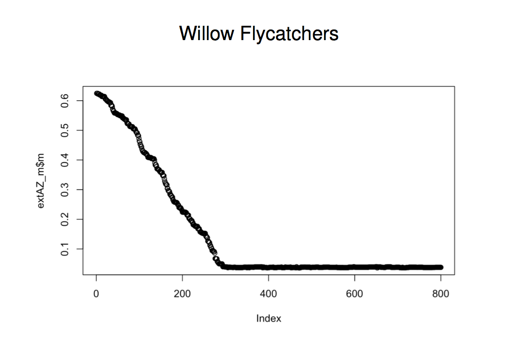{.method-figure fig-alt="Original willow flycatcher MCMC trace for the heterozygote-miscall parameter, declining during its initial transient."}
:::
::: {.column width="50%"}
**Lobsters**

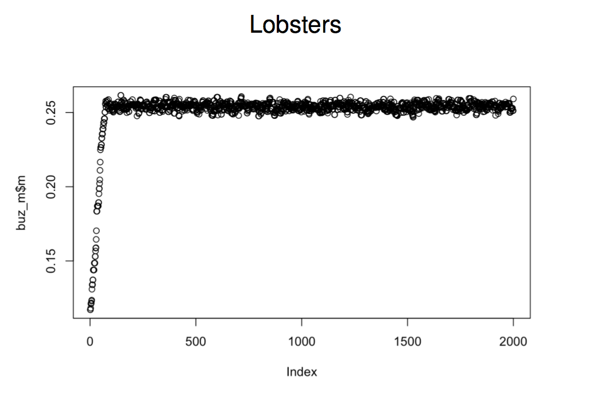{.method-figure fig-alt="Original lobster MCMC trace for the heterozygote-miscall parameter, approaching roughly one-quarter."}
:::
:::

Infer $m$ while allowing uncertainty in allele frequencies and latent true genotypes. Assess burn-in, mixing, and convergence before interpreting summaries.

## Published-data survey: bonnethead shark {.genotyping-figure}

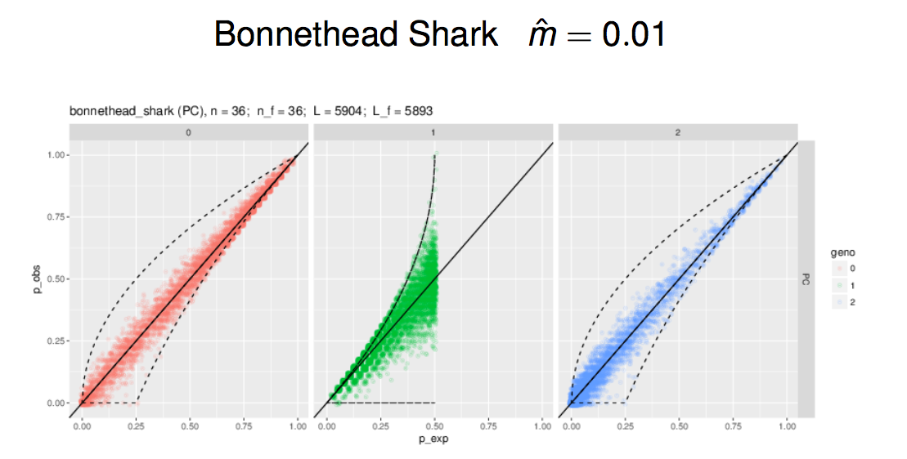{.genotyping-wide fig-alt="Original bonnethead-shark genotype-frequency diagnostic, labelled with estimated miscall rate 0.01."}

The original analysis estimated $\widehat m=0.01$.

## Published-data survey: red drum {.genotyping-figure}

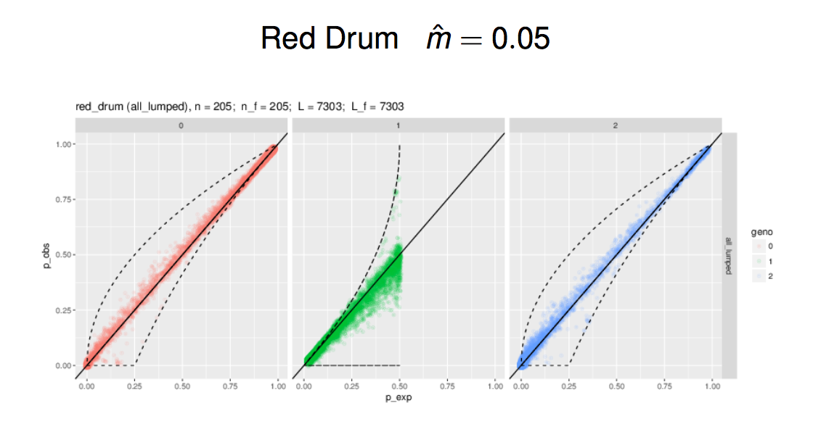{.genotyping-wide fig-alt="Original red-drum genotype-frequency diagnostic, labelled with estimated miscall rate 0.05."}

The original analysis estimated $\widehat m=0.05$.

## Published-data survey: Chinook salmon {.genotyping-figure}

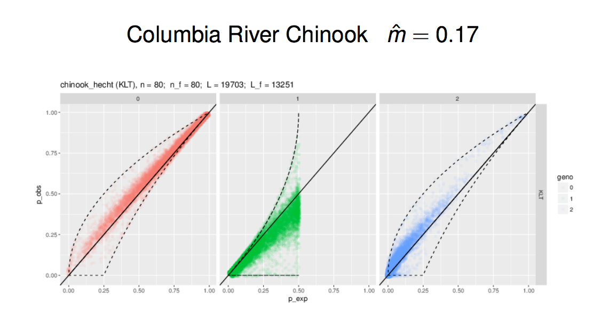{.genotyping-wide fig-alt="Original Columbia River Chinook salmon diagnostic, labelled with estimated miscall rate 0.17."}

The original analysis estimated $\widehat m=0.17$.

## Published-data survey: snails {.genotyping-figure}

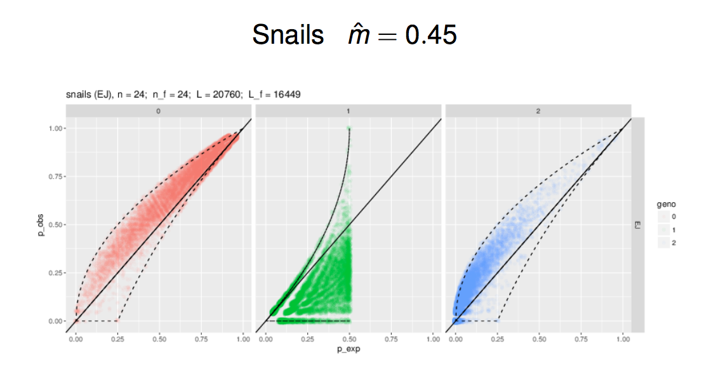{.genotyping-wide fig-alt="Original snail genotype-frequency diagnostic, labelled with estimated miscall rate 0.45."}

The original analysis estimated $\widehat m=0.45$.

## Miscall and read depth {.genotyping-figure}

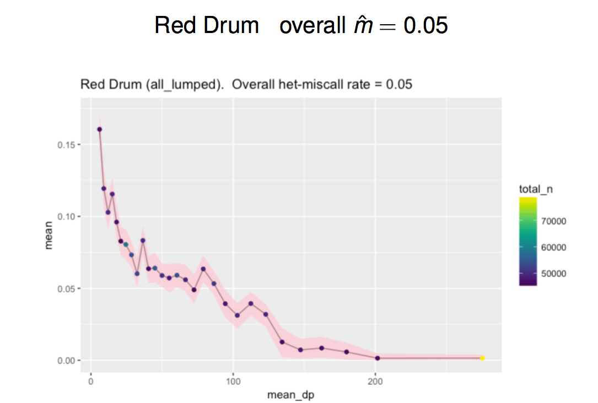{.genotyping-wide fig-alt="Original red-drum plot shows higher heterozygote-miscall estimates at low mean read depth and lower estimates at high depth."}

In this red-drum example, low-depth groups have higher estimated miscall rates.

Check accuracy and coverage distributions; **mean depth alone can conceal poorly covered loci or samples**.

## Het miscall effect on downstream analyses

Depends on what you are using RAD for

- **Allele frequencies:** symmetric heterozygote-to-homozygote errors can partly cancel in the average allele count.  (Note a huge deal)
- **Heterozygosity and outlier analyses:** dropout changes genotype frequencies and can distort the patterns being tested. (Potentially problematic)
- **Relationship inference:** an error can turn a genuine relative into an apparent mismatch. (Downright disastrous)

An error rate that seems modest for one task can be unacceptable for another.

## RAD for CKMR: take-home messages

- Use pilot data to evaluate error, missingness, and locus consistency.
- Avoid treating “more than 10×” as a universal accuracy threshold.
- Estimate genotypes using their posterior with a proper model.
- Examine heterozygote miscalls, not just the percentage of missing calls.
- RAD can support marker discovery or independent confirmation of candidate kin pairs.
- Decide whether it meets the precision requirements of the particular CKMR study.

## Capture arrays {.genotyping-figure}

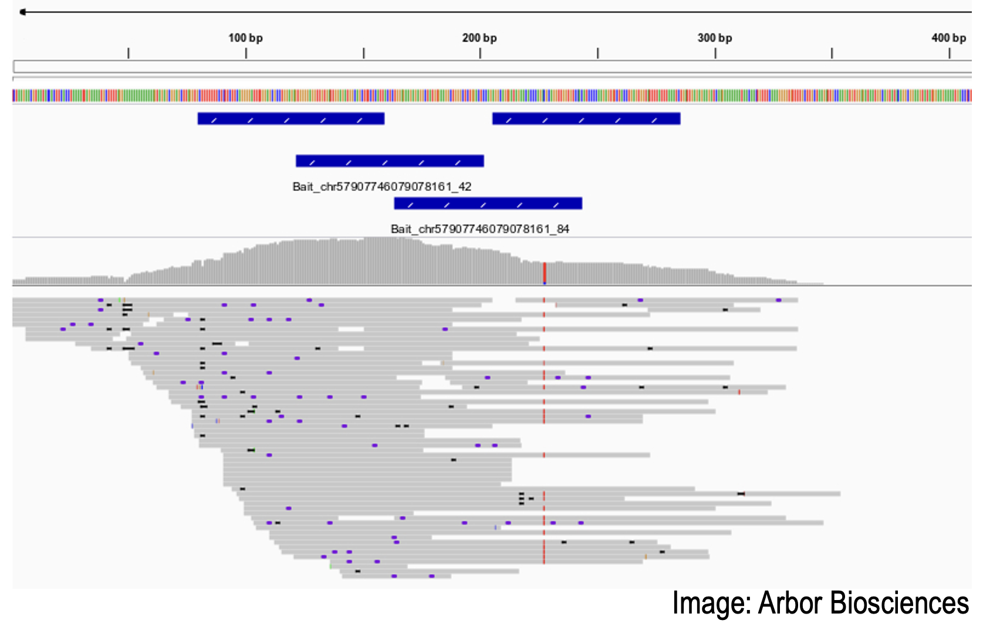{.genotyping-wide fig-alt="Capture probes enrich selected genomic fragments; original image credit Arbor Biosciences."}

Probes or “baits” hybridize to selected sequences, enriching the library for those targets.

Cost and performance depend on probe design, sample scale, and the sequencing allocation.

## RAD plus capture

- Prepare a RAD library with sample indexes.
- Enrich a selected subset of RAD fragments using capture probes.
- Concentrate sequencing on chosen loci rather than every fragment in the original RAD library.
- Examples include **RAPTURE** and **DArTcap**.
- DArtcap was a DArt service at some point.  It might be renamed.  
- (Discussion topic for later:
   doing genotyping in-house or through a service..)

## Amplicon sequencing

Multiplexed PCR primers amplify selected regions of the genome.

- Target a small set of informative regions or a larger panel.
- Allocate enough usable reads to call the two gene copies reliably.
- Retain multiple linked SNPs as **microhaplotypes** when reads establish their phase.
- Panel performance matters as much as nominal marker count.

::: {.source-line}
[GT-seq: Campbell et al. (2015)](https://doi.org/10.1111/1755-0998.12357)
:::

## Developing an amplicon panel

Panel development is iterative:

- Remove loci with apparent null alleles.
- Remove loci affected by paralogs.
- Rebalance or remove “high-rollers” that consume a disproportionate share of reads.
- Recheck coverage and genotype quality after each revision.

This can be laborious, and involves a sunken cost, but is necessary.

- Once done, amplicon sequencing can be quite cost effective.

## What variation do we retain?

Once coverage and genotype quality are adequate, a sequenced region can yield:

- A single SNP
- A **microhaplotype** combining linked variants
- A microsatellite allele inferred from its sequence

## Single SNPs in amplicons

* Within each locus (small sequenced region). Often only one SNP (possibly out of several) will be retained.  
* Convenient for methods that require biallelic markers.
* Simple genotyping error models are realistic.
* Does not make optimal use of the information in the data.

## Phase of SNPs is often ignored

If this is observed:

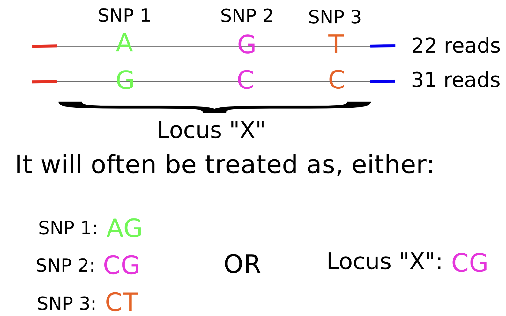{fig-align="center"}

The first treats the genotypes as independent (wrong!); the second tosses useful info

## Microhaplotypes retain the phase {.phase-slide}

If this is observed:

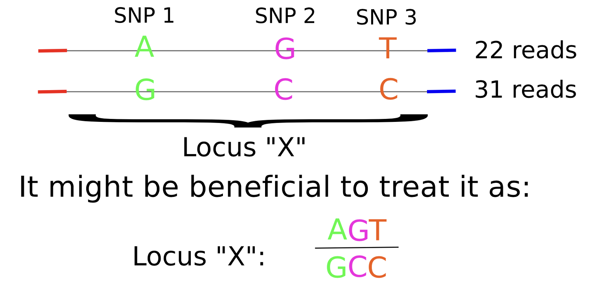{fig-align="center"}

Each haplotypic combination (AGT or GCC) is an allele.

## Inspecting microhaplotype calls {.genotyping-figure}

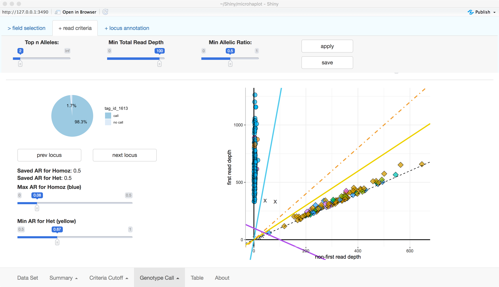{.genotyping-wide fig-alt="Original microhaplot application screenshot displaying read depth, allelic read ratios, and genotype-call controls."}

Inspect read support, allelic balance, and locus behavior to build well-behaved panels.

[`microhaplot` software](https://github.com/ngthomas/microhaplot)

## Increased heterozygosity {.genotyping-columns}

::: {.columns}
::: {.column width="57%"}
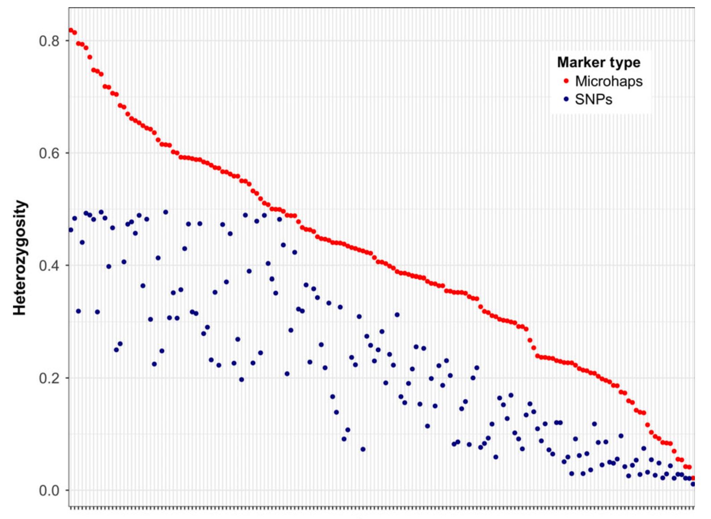{.genotyping-tall fig-alt="Baetscher et al. figure compares heterozygosity at 165 microhaplotypes with the most informative single SNP at each locus; microhaplotypes are generally higher."}
:::
::: {.column width="43%"}
At 165 loci, compare each microhaplotype with the single SNP having the highest minor-allele frequency in that region.

A biallelic SNP has maximum expected heterozygosity **0.5**.

A multi-allelic microhaplotype can exceed that limit.

$\uparrow$ heterozygosity = $\uparrow$ Power for kinship detection
:::
:::

::: {.source-line}
[Baetscher et al. (2018), Figure 2](https://doi.org/10.1111/1755-0998.12737)
:::

::: {.notes}
2019 slide 44. Baetscher et al. 2018 Figure 2, doi:10.1111/1755-0998.12737. Original plot retained.
:::

## Increased power for relationship inference {.genotyping-columns}

::: {.columns}
::: {.column width="57%"}
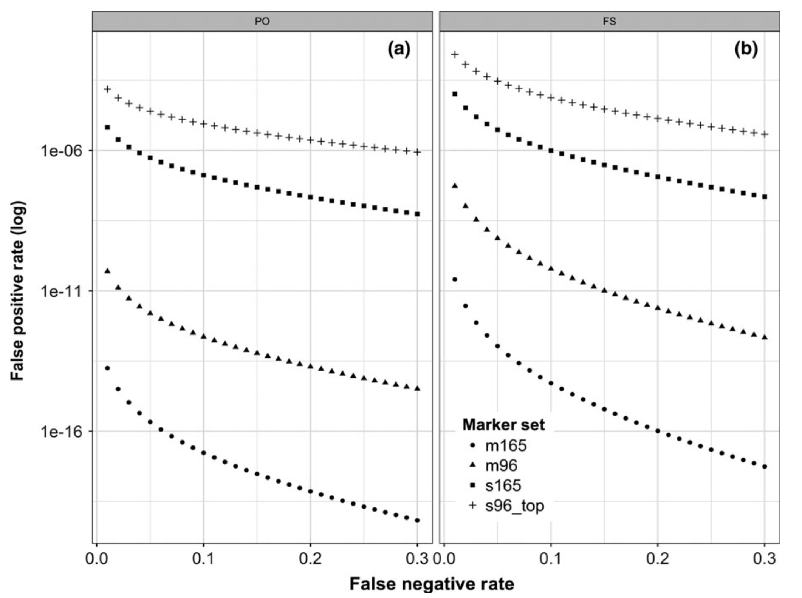{.genotyping-tall fig-alt="Baetscher et al. Figure 3 compares false-positive rates against false-negative rates for parent-offspring and full-sibling identification using microhaplotypes and SNPs."}
:::
::: {.column width="43%"}
The simulations compare parent–offspring and full-sibling matching using:

- 165 microhaplotypes
- 165 SNPs
- 96 microhaplotypes
- 96 high-heterozygosity SNPs

Evaluate both **false positives and false negatives** when choosing a panel.
:::
:::

::: {.source-line}
[Baetscher et al. (2018), Figure 3](https://doi.org/10.1111/1755-0998.12737)
:::

::: {.notes}
2019 slide 45. Baetscher et al. 2018 Figure 3, doi:10.1111/1755-0998.12737. Original plot retained.
:::

## You still need a lot of amplicons for half-siblings

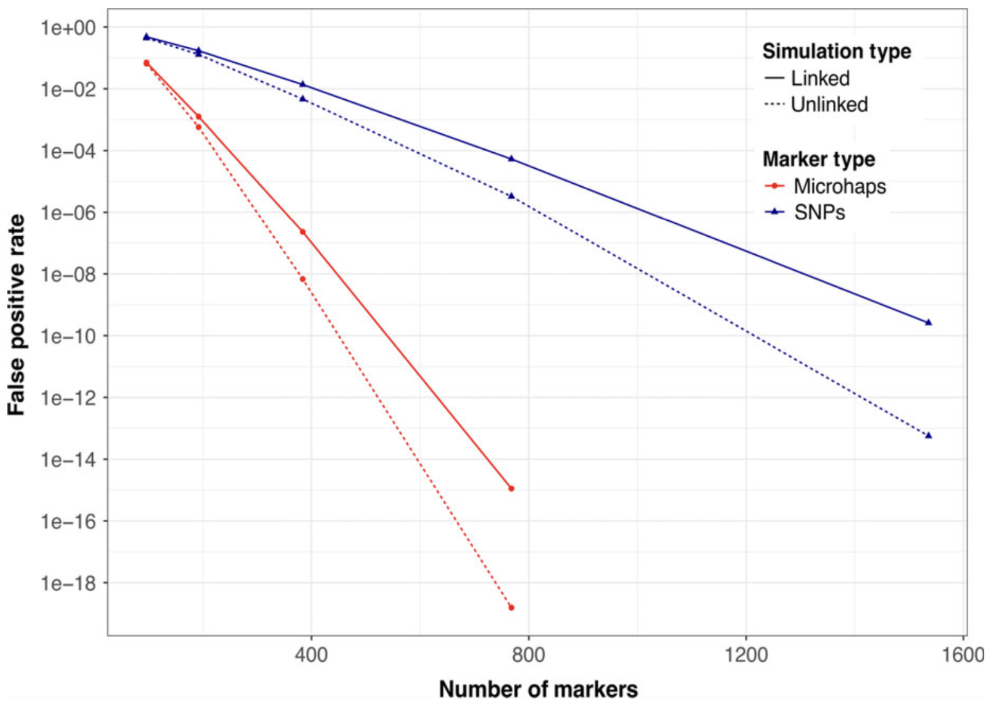{fig-align="center"}

* 15,000 samples $\Longrightarrow$ $\approx$ 100 million pairs $\Longrightarrow$ Need FPR $\approx 10^{-9}$ 
* That is at least two plates of amplicons

## Microhaplotypes in a CKMR panel

- Multiple alleles can make each independently inherited locus more informative.
- Retaining phase can improve power without adding a new amplicon.
- Loci still need reliable genotype calls and suitable population allele-frequency estimates.
- Dependence among loci from physical linkage remains relevant (though reduced compared to dense SNP data).
- Validate performance for the relationship classes the study actually uses (CKMRsim).

## Microsatellites from sequencing {.genotyping-figure}

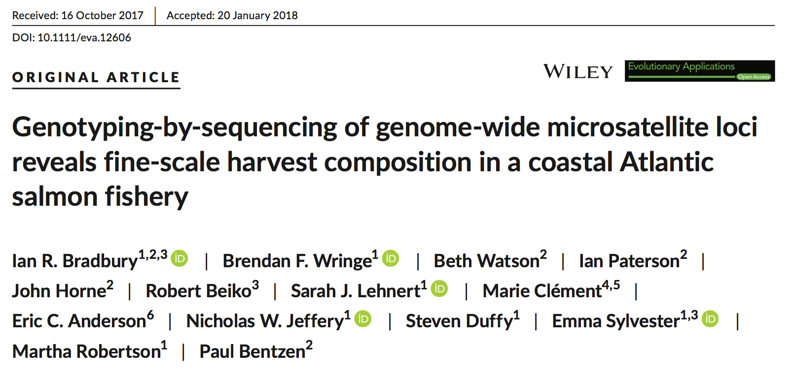{.genotyping-wide fig-alt="Bradbury et al. study on genotyping-by-sequencing of genome-wide microsatellite loci in Atlantic salmon."}

Amplicon sequencing can also recover microsatellite variation. Assess reproducibility, allele calling, and error before relying on it for kin identification.

::: {.source-line}
[Bradbury et al. (2018)](https://doi.org/10.1111/eva.12606); [MEGASAT: Zhan et al. (2017)](https://doi.org/10.1111/1755-0998.12561)
:::

## Genotyping error models

- **Biallelic SNPs:** a dropout-only model can be a useful starting approximation; check whether it matches the data.
- **Microhaplotypes and microsatellites:** errors can change one heterozygote into another, so a single dropout parameter may be insufficient.
- Systematic allele-specific loss differs from stochastic loss at low coverage.
- Assess how error changes the distributions of kinship evidence and the resulting false-positive and false-negative rates.

## Null alleles occur in amplicon sequencing as well as RAD-seq

96 microhaplotypes in 6,000 kelp rockfish

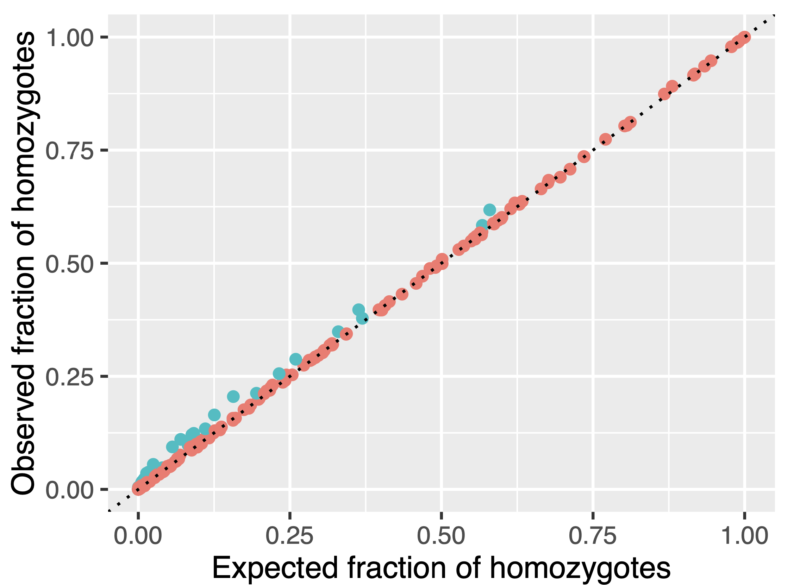{fig-align="center"}

Each point is an an allele 

Green points have too many homozygotes ==> null alleles at the locus

## DaRTTag:  "Probe-based amplicon creation with a common primer pair"

The "probes" consist of two "sticky-bits" on a "backbone" designed to target flanking sequence
around a variant or variants you want to sequence.

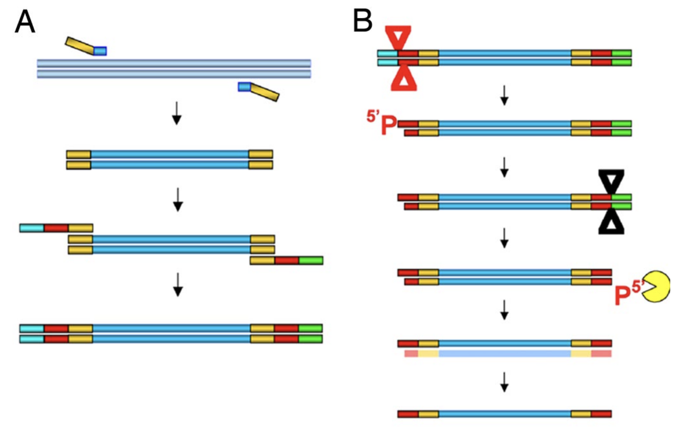

(Krishnakumar et al. 2008, PNAS)

## DaRTTag:  "Probe-based amplicon creation with a common primer pair"

The two sticky ends of the probe make a circle and the target sequence is synthesized
(and gap-filled).

:::{.columns}
:::{.column width="60%"}
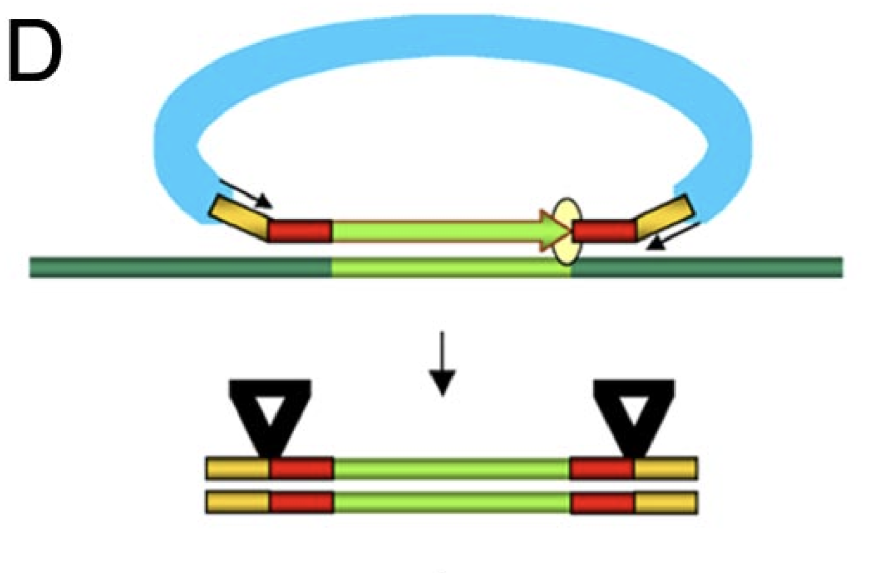
:::
:::{.column width="40%"}
Not shown in this original paper:

1. additional digestion step removing non-circularized DNA.
2. addition of barcodes and Illumina adapters.

The cool thing is that after that you have amplicons, but all the different
target sequences are using the same pair of primers.

:::
:::

(Krishnakumar et al. 2008, PNAS)

## DaRTTag:  "Probe-based amplicon creation with a common primer pair"

* Although this uses probes, it is fundamentally not a capture array.
* Although this PCR-amplifies little amplicons, it is fundamentally different than
"GTseq" or standard amplicon approaches.
* In GTseq, each amplicon is amplified using its own primer pair.
* When many primer pairs are placed together into a PCR soup, they don't
  often play nicely
    - beyond 400 or 500 amplicons, things get squirrely
* Apparently not so with DaRTTag.  You can put thousands of targets in a single
  panel
* Matt L: $12 per sample, extraction included for 4,000 SNPs?
* These can be analyzed as microhaplotypes, too.
* Targeting new variants is straightforward if you know the flanking sequence.

## Maternally inherited mtDNA

:::{.columns}
:::{.column width="45%"}
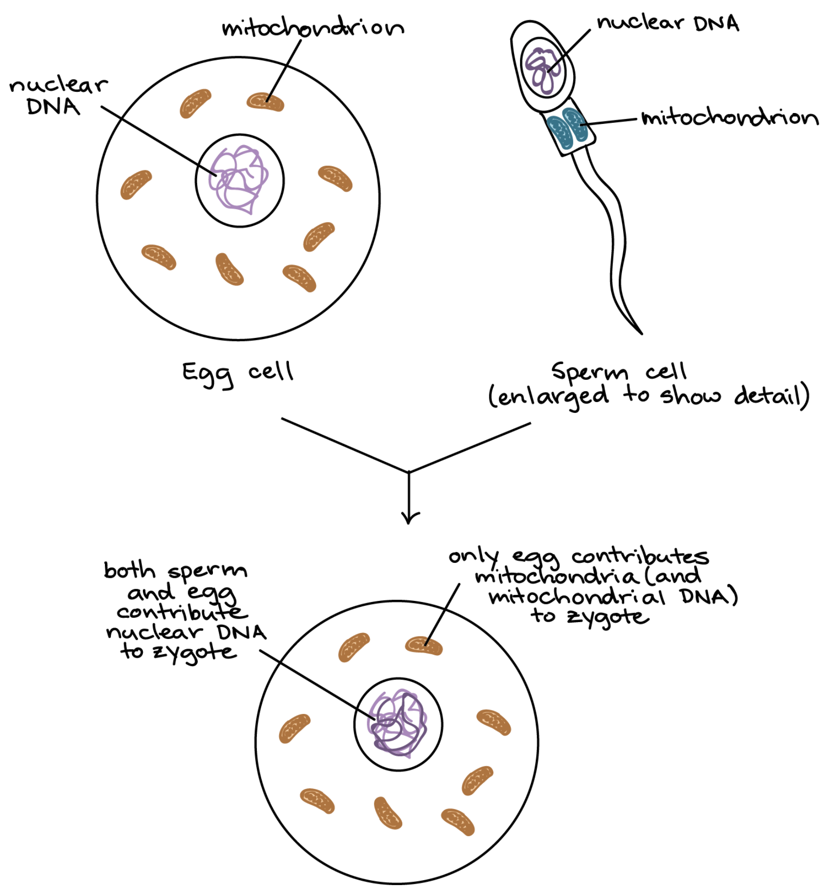
:::
::: {.column width="55%"}
* mtDNA is a separate DNA molecule housed in the mitochondria
* maternally inherited; circular, $\approx$ 16,000 bp 
* Multiple copies in each mitochondrion + lots of mitochrondia = lots of copies
* Typically all copies within an individual are identical in sequence

* Used to be mtDNA was the _only_ gene sequence available
* Fell out of favor when nuclear genotyping came online, but....
* Super useful for determining the sex of the unobserved parent of two half-siblings

:::
:::

## mtDNA inheritance and and half-sibling pairs

* mtDNA carried by an individual is IBD with that carried by Mom
* Consequently it is also identical in state / sequence
* If the kids $A$ and $B$ are a maternal half-sibling pair (MHSP), then they both
inherited their mtDNA from mom.
$$
\begin{aligned}
P(M_A = m_i, M_B = m_i \mid \mathrm{MHSP}) &= f(m_i) \\
P(M_A = m_i, M_B = m_j \mid \mathrm{MHSP}) &= 0 \\
\end{aligned}
$$
* If they are paternal half sibs, the each got their mtDNA, independently, "from the population"
$$
\begin{aligned}
P(M_A = m_i, M_B = m_i \mid \mathrm{PHSP}) &= [f(m_i)]^2 \\
P(M_A = m_i, M_B = m_j \mid \mathrm{PHSP}) &= f(m_i)f(m_j) \\
\end{aligned}
$$

## mtDNA inheritance and and half-sibling pairs

* Easiest to distinguish Paternal from Maternal when mtDNA haplotypes are numerous
and all at low freuquency.
* Best way to achieve that is by sequencing the whole mtDNA molecule.
* Only need to do this on identified HSPs
* It exists at high copy number (100-1000) in most cells.  So, if you target 1X coverage
you should get 100-1000 reads at any place in the mtDNA on average.
* Phil Morin's early-days WG sequencing stories 
* In high diversity species, there are many different haplotypes.  Not necessarily so
in small populations.

## Epigenetic Ageing

Much gene regulation is orchestrated by methylation of CpG sites.

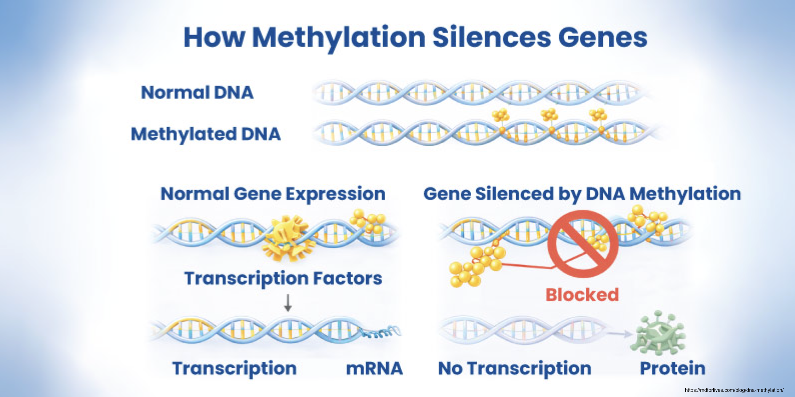
Certain sites predictably change in methylation status through the aging process

## Epigenetic Ageing

Methylation of CpG sites can be detected through bisfulfite sequencing

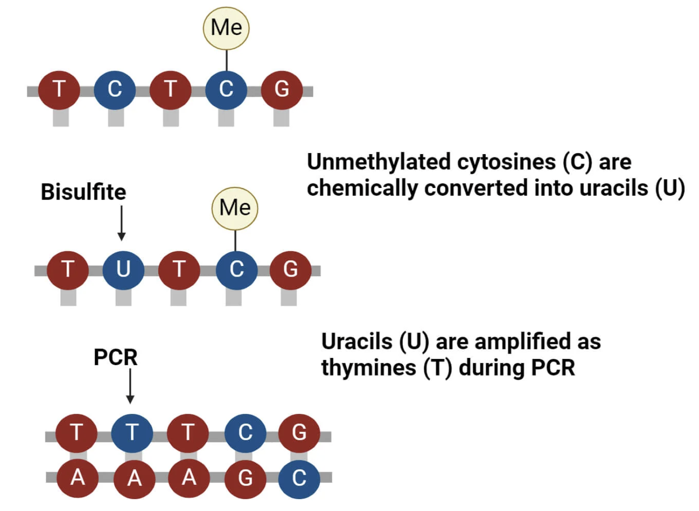{fig-align="center"}

## Epigenetic Ageing

* Do bisulfite sequencing on a known-age training set of individuals
* Target lots of CpG sites (bisulfite RADseq, etc.)
* Find those sites that predictably change with age
* Test prediction on a test set
* Design amplicons and DaRTTAG type assays for high-throughput bisulfite sequencing

## Epigenetic Ageing

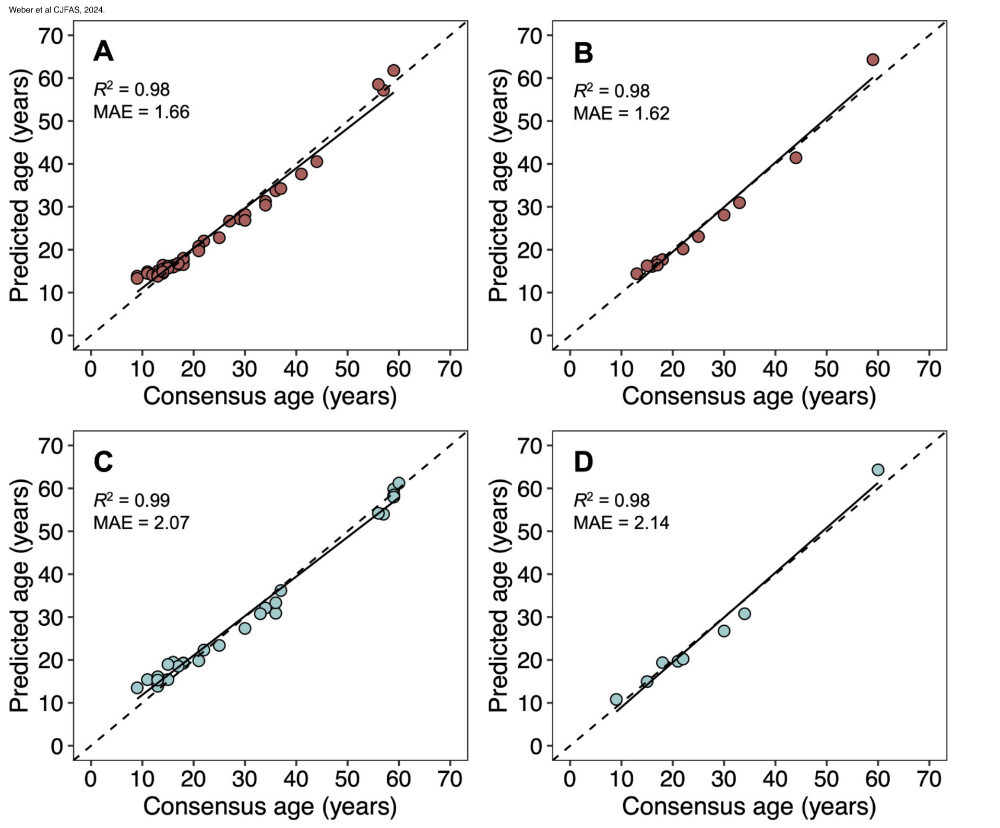{fig-align="center"}
Available from the same tissue sample as the rest of the DNA

## Conclusions

- Sequencing depth must be allocated across individuals and genomic regions.
- Missing calls and incorrect non-missing calls are different problems.
- RAD heterozygote-miscall diagnostics provide a useful warning, but depend on population and error-model assumptions.
- Targeting loci can concentrate coverage; retaining microhaplotypes can retain more information per locus.
- Choose and validate a genotyping panel against the needs of the CKMR design.
- Clean and complete (no holes!) genotyping data is golden.
- Messier, holey data can be handled but it requires a LOT more work and gnashing of teeth. We will briefly descend to the 9th Bolgia of Hell to meet such Sowers of Discord later this week.
- Sex ID markers can be added to a standard amplicon or DaRTTAG panel.

